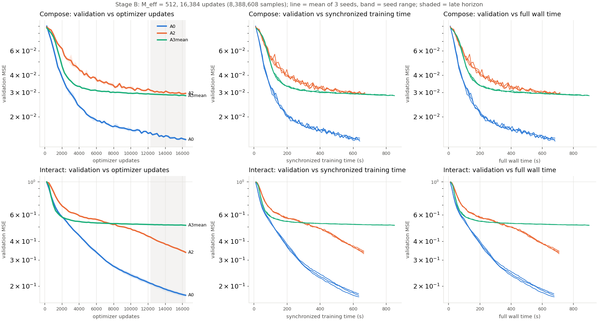
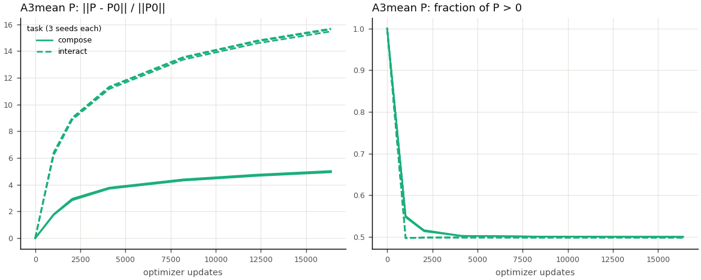
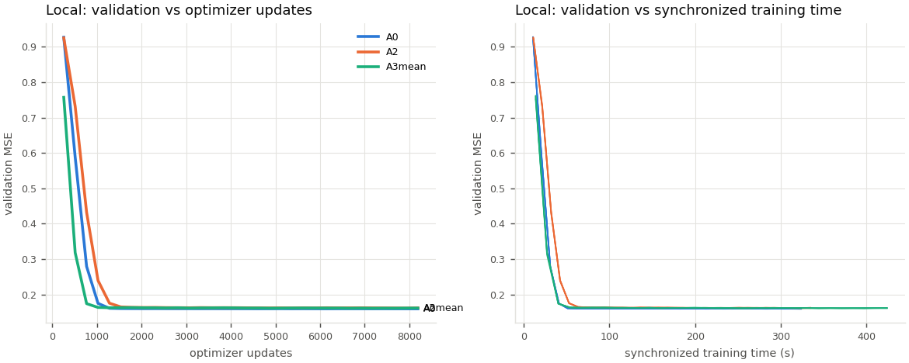
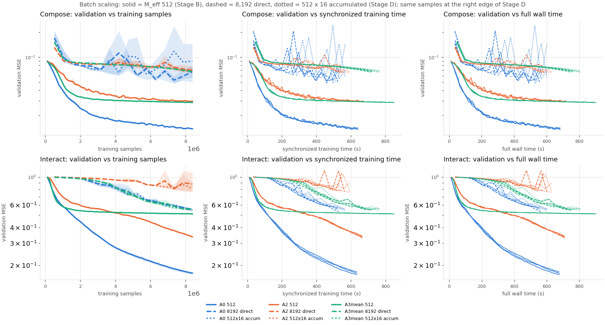

# A3mean long-horizon confirmation and batch scaling: experiment report

**Status: experimental. Nothing here changes production defaults or `main`.** All numbers are from synthetic teachers on one
RTX 3090. No real dataset was available, so nothing here is real-world validation. Training rows are independent Gaussian
vectors; they aren't video frames or robot trajectories.

Generated tables with every per-seed value: [`tables.md`](../../sparse_pooling/results/learned_reduction_followup/tables.md).
Preregistration: [`configs/learned_reduction_followup/manifest.json`](../../configs/learned_reduction_followup/manifest.json).
Previous study: [`learned_sliding_window_reduction.md`](learned_sliding_window_reduction.md).

## Answer

**No. After fresh-data tuning, A3mean doesn't offer a useful quality versus training-time tradeoff. Keep A0.**

The earlier A3mean lead came from an under-tuned A0. Re-tuned on fresh data, A0's learning rate rose 9x, from 0.003 to 0.027.
With that rate, A0 beats A3mean on both primary tasks at the preregistered endpoint, by a wide margin, and also costs 1.33x less
per update.

| Primary endpoint (locked test, 16,384 updates, M_eff = 512, 3 paired seeds) | A0 | A3mean | A3mean - A0, % of A0 | 95 % CI | Holm p |
|---|---:|---:|---:|---:|---:|
| Compose | 0.01384 | 0.02825 | **+104.0** | [+97.2, +110.8] | 0.0002 |
| Interact | 0.17358 | 0.51329 | **+195.7** | [+189.2, +202.2] | 0.0002 |

Positive means A3mean has the higher (worse) loss. Both effects far exceed the 2 % "small" rule, and every seed agrees.

### The practical questions

| Question | Answer |
|---|---|
| Does A3mean keep a meaningful improvement at the long endpoint and at equal time? | **No.** It's worse at 16,384 updates, at equal training time and at equal wall time. It's also worse at every test milestone from 4,096 updates on. |
| Is its advantage mainly earlier convergence, and is the extra cost worth it? | Only on Interact, and only very early: at 1,024 updates its validation loss is 4 % below A0's (0.699 vs 0.729). By 2,048 the two are tied. Measured at equal training time it never leads: +5.5 % at 79 s, interval [-0.3, +11.3]. The extra 1.33x cost buys nothing. |
| Does A2 recover most of the benefit? | There is no A3mean benefit to recover. A2 is worse than A0 on both tasks at 16,384 updates: +112 % on Compose, +93 % on Interact. A2 keeps improving on Interact, though, and nearly reaches A0 at 32,768 updates (0.130 vs 0.124 test). On Interact A2 beats A3mean from about 8,000 updates on. |
| Is A3mean competitive at M_eff = 8,192 at equal samples or wall time? | **At equal samples it ties A0** (+0.4 % and +0.3 %; both intervals span zero). **At equal time it loses**: +45.5 % test on Interact. More importantly, every model is much worse at M_eff 8,192 than at 512 for the same samples. |
| How much does a physical batch of 8,192 gain over accumulating 16 x 512? | **Same quality, about 7 % faster.** Direct runs take 515 / 540 / 706 ms per update for A0 / A2 / A3mean; accumulated runs take 553 / 579 / 749 ms. No quality difference is resolved. Direct costs up to +0.45 GiB more peak memory (A2; A3mean +0.36). |
| Does Local expose a regression? | Small but consistent. A3mean is +1.33 % worse than A0 on test at 8,192 updates (interval [+0.84, +1.82]), below the 2 % rule. A2 is +1.59 % worse. Local barely trains for any model: about 0.160 from update 2,048 on. |
| Are corrected memory totals acceptable on the RTX 3090? | **Yes.** A3mean peaks at 1.93 GiB at M = 512 and 2.30 GiB at M = 8,192, against 1.73 and 1.87 GiB for A0. That's under 10 % of 24 GiB. |

### Recommendation

1. **Keep A0, with the re-tuned fresh-data learning rate.** The tuned rate for A0 is lr_w 0.027 and lr_small 0.009 at
   M_eff = 512. It was the top edge of the allowed grid, so A0 may improve further. This would only widen its lead.
2. **Don't continue A3mean toward real-task validation** on this evidence. Its validation loss levels off by about 4,000 updates
   on both tasks, while A0 and A2 keep falling (see [Why A3mean levels off](#why-a3mean-levels-off)).
3. **Don't offer A2 as a cheap option either.** It's never better than A0 here. Its late Interact catch-up is a reason to watch
   it, not to adopt it.
4. **Don't use M_eff = 8,192 for this model family** at these learning rates. A small batch reaches 58-79 % lower loss for
   the same samples, with one exception (A3mean Interact, -7.5 %).
5. **Further training doesn't change the answer.** The 32,768-update extension widened A0's lead to +156 % and +299 %.
   Real-data validation would be needed before any production change. On present evidence the candidate for that is A0 at the
   new learning rate, not a reducer.

## How to read these results

| | |
|---|---|
| **Preregistration** | `configs/learned_reduction_followup/manifest.json`, committed in `8d7690e` at 13:00:48 on 2026-11-07, before any campaign job started. The campaign began at 13:10. Manifest SHA-256 `2533530c...ffcbaf`. |
| **Start commit** | `a3ad071` (previous study's final commit). Implementation commit `8d7690e`. All jobs ran from a frozen detached worktree at `8d7690e`, and every record carries a clean provenance check. |
| **Data** | Canonical 512-row blocks, each seeded by SHA-256 of its name (`lrf_stream.py`). Fresh blocks, no repetition: training reads 16,384 blocks per run at M_eff = 512. Validation uses 8 fixed blocks (4,096 rows), test 16 fixed blocks (8,192 rows). Both held-out sets are fixed across seeds. |
| **Test lock** | Test losses were readable only with `test_unlock.json`. It was written at 08:27 on 2026-11-08, after every selection and the extension decision were final. Before that, no test value was read. The only exception was a discarded 4-update smoke check of the lock itself. |
| **Selection** | Learning rates were tuned on validation only, seed 0. The score is the mean of the last four evaluations. No checkpoint was selected by test loss. |
| **Statistics** | n = 3 paired seeds; 95 % t interval with 2 df; closed-form two-sided p. Holm correction applies only to the two primary tests. Everything else is secondary or exploratory, and its p values are unadjusted. |
| **dX policy** | Every quality run used the experimental `mt2_nw4_wg2` dX tiling. The production-validated `mt4_nw8_wg4` was timed for A0 only: at M = 8,192 it's 536.5 ms against 521.4 ms. |
| **Teachers** | Synthetic, and fixed across student seeds. Seed variation covers student init and the training stream only. |

## Stage A: fresh-data tuning (M_eff = 512, seed 0, 2,048 updates, validation)

The grid was x {1/3, 1, 3} times the recovered prior learning-rate pair, with one edge extension where the best point was on an
edge. That gives at most 4 trials per cell.

| Cell | Prior pair (lr_w / lr_small) | Selected | Trials | Note |
|---|---|---|---:|---|
| A0 Compose | 0.003 / 0.001 | **x9: 0.027 / 0.009** | 4 | **Still at the top edge after the one allowed extension** |
| A0 Interact | 0.003 / 0.001 | **x9: 0.027 / 0.009** | 4 | **Still at the top edge after the one allowed extension** |
| A2 Compose | 0.003 / 0.0003 | x1 | 3 | interior |
| A2 Interact | 0.003 / 0.0003 | x3: 0.009 / 0.0009 | 4 | Extension to x9 failed (0.997) |
| A3mean Compose | 0.0003 / 0.0003, P x0.3 | x1 | 3 | interior |
| A3mean Interact | 0.001 / 0.0003, P x0.3 | x1 | 3 | interior |

**Inherited-LR anchors confirm the cause.** A0 at its old rate 0.003, seed 0, gives validation loss 0.0302 on Compose and 0.584
on Interact at 8,192 updates. At the tuned rate it gives 0.0172 and 0.2685. A3mean gives 0.0300 and 0.524. So against the old A0,
A3mean ties on Compose and leads Interact by about 10 %, which is the previous study's picture. Against the tuned A0 it loses
badly. The manifest declared anchors only where tuning changed the historical rate of A0 or A3mean. A3mean's rates didn't change, so
only A0 was anchored. A2's Interact rate changed (x3), but A2 anchors weren't declared.

## Stage B: long horizon (M_eff = 512, 16,384 updates, 3 seeds; 18 runs)



| Task | Model | test 4,096 | test 8,192 | test 16,384 | val drop 12,288 to 16,384 |
|---|---|---:|---:|---:|---:|
| Compose | A0 | 0.02358 | 0.01729 | **0.01384** | 10.9 % |
| Compose | A2 | 0.04314 | 0.03250 | 0.02942 | 5.0 % |
| Compose | A3mean | 0.03296 | 0.02980 | 0.02825 | 2.5 % |
| Interact | A0 | 0.43125 | 0.26850 | **0.17358** | 16.7 % |
| Interact | A2 | 0.58998 | 0.51746 | 0.33439 | 21.0 % |
| Interact | A3mean | 0.54274 | 0.52568 | 0.51329 | 1.2 % |

Secondary contrasts (test, % of the second model; unadjusted):

| | 4,096 | 8,192 | 16,384 |
|---|---:|---:|---:|
| Compose, A3mean - A0 | +39.8 [+31.7, +47.8] | +72.4 [+60.5, +84.2] | +104.0 [+97.2, +110.8] |
| Compose, A3mean - A2 | -23.6 [-34.6, -12.6] | -8.3 [-15.4, -1.2] | -4.0 [-8.6, +0.6] |
| Compose, A2 - A0 | +83.0 | +88.0 | +112.5 |
| Interact, A3mean - A0 | +25.9 [+21.3, +30.4] | +95.8 [+89.2, +102.4] | +195.7 [+189.2, +202.2] |
| Interact, A3mean - A2 | -8.0 [-9.5, -6.5] | +1.6 [+0.2, +3.0] | +53.5 [+48.6, +58.4] |
| Interact, A2 - A0 | +36.8 | +92.7 | +92.7 |

**Equal training time** (validation, interpolated within the shortest run; A3mean - A0): Compose +53.5 % at 80 s, +112 % at
640 s. Interact +5.5 % [-0.3, +11.3] at 79 s, +197 % at 633 s. Wall-time results agree to within 0.2 points.

**Test at equal training time:** A0's endpoint (about 640 s) against A3mean's latest retained milestone that isn't later. That
milestone is update 12,288 on Compose (638 s) and update 8,192 on Interact (425 s): +109 % and +203 %.

**Final weights vs validation-selected checkpoint:** among the retained milestones, validation selected the final checkpoint in
all 18 runs. The two readings are identical.

**Training diagnostics, last evaluation:** there's no generalization gap for any model. Validation minus loss on already-seen
fixed blocks is between -0.0007 and +0.0022. All runs stayed finite. Compose curves for A0 and A2 are noisier: the worst late
validation rise is 7-8 %, against 1.7 % for A3mean.

### Why A3mean levels off



The first-stage weights P start at the mean, 1/2,048 = 4.88e-4. Within the first 1,024 updates they become a sign-symmetric
distribution centred on zero: 50.0 % positive and mean about -1e-6 at 16,384 updates, in every seed. Relative movement
||P - P0|| / ||P0|| reaches 5.0 on Compose and 15.6 on Interact.

So the mean initialization doesn't survive training. The validation plateau starts once P has lost its averaging structure.
The P gradient-to-weight ratio falls from about 0.13 at update 1,024 to 0.012-0.035 at 16,384. Whether a constrained or slower P
would avoid the plateau wasn't tested. It's a hypothesis, not a finding.

### Extension to 32,768 updates (secondary; gate declared beforehand)

The extension gate triggered on validation before the unlock: every A0 and A2 cell, and A3mean Compose (2.5 %), dropped at least
2 % from 12,288 to 16,384 updates. A3mean Interact dropped 1.2 %. The extension fit the budget, so all 18 runs were extended together from their full checkpoints. The primary
endpoint stays at 16,384.

| Test at 32,768 | A0 | A2 | A3mean | A3mean - A0 |
|---|---:|---:|---:|---:|
| Compose | 0.01058 | 0.02376 | 0.02714 | +156.4 % [+152.0, +160.7] |
| Interact | 0.12448 | 0.13043 | 0.49634 | +298.7 % [+292.7, +304.8] |

### Secondary width H = 12,582,912 (8,192 updates, primary-width learning rates, not re-tuned)

Same picture: A3mean - A0 on test is +75.9 % [+71.3, +80.6] on Compose and +92.4 % [+91.1, +93.7] on Interact. Each update takes
44.0 ms for A0 and 58.7 ms for A3mean (1.33x).

## Stage C: Local (M_eff = 512, 8,192 updates, 3 seeds)

Tuning used 3 candidates (x {1/3, 1, 3}) plus one edge extension. **A2 and A3mean were selected at the lower edge after the
extension** (x1/9). A0 was selected at x1/3; its x1/9 trial scored much worse (0.353).

| Test at 8,192 | A0 | A2 | A3mean | A3mean - A0 | A3mean - A2 |
|---|---:|---:|---:|---:|---:|
| Local | 0.15937 | 0.16190 | 0.16149 | +1.33 % [+0.84, +1.82] | -0.25 % [-0.64, +0.13] |



## Stage D: batch scaling (M_eff = 8,192, 1,024 updates = 8,388,608 samples, 3 seeds; 36 runs)

Tuning (256 updates, seed 0, x {1, 4, 16} of the Stage A pair) chose x4 for A0, which is interior. **It chose x1 for A2 and A3mean,
the lower edge, and this stage had no edge extension by design.** On Interact the tuning signal was weak: every candidate was at
0.97-1.0 validation loss after 256 updates.



| Test at 8,388,608 samples | A0 | A2 | A3mean |
|---|---:|---:|---:|
| Compose, small (M_eff 512, Stage B u16,384) | **0.01384** | 0.02942 | 0.02825 |
| Compose, direct 8,192 | 0.06726 | 0.06971 | 0.06755 |
| Compose, accumulated 512 x 16 | 0.09032 | 0.06960 | 0.06755 |
| Interact, small | **0.17358** | 0.33439 | 0.51329 |
| Interact, direct 8,192 | 0.55296 | 0.88659 | 0.55474 |
| Interact, accumulated 512 x 16 | 0.55177 | 0.81529 | 0.56064 |

- **Equal samples, small minus large (direct), % of large:** A0 -79.4 / -68.6, A2 -57.8 / -62.3, A3mean -58.2 / -7.5
  (Compose / Interact). The small batch wins every cell.
- **Equal updates (1,024; diagnostic only, 16x samples for large):** on Interact the small batch is 32 % (A0) and 26 % (A3mean) worse than the large one.
- **Equal training time within the overlap:** small beats large at every point for every model.
- **Large batch, A3mean vs A0 (test, direct, 1,024 updates):** +0.43 % [-50.0, +50.9] on Compose and +0.32 % [-11.7, +12.4] on
  Interact. The Compose interval is wide because A0 at lr_w 0.108 is unstable: its validation curve jumps between 0.05 and 0.14
  across checkpoints. At equal training time A3mean is worse: +45.5 % test on Interact (its update-512 checkpoint against A0's
  update 1,024), and +14 % validation at 524 s.
- **Direct vs accumulated, same learning rate and samples:** no resolved quality difference; every interval spans zero. A3mean
  Compose reproduces to 5 digits in all three seeds. Where the runs differ, the gap comes from high-LR instability amplifying
  summation-order differences, not from the batch mode: the gate showed a gradient difference of at most 5.1e-5 relative.

**Time for 8,388,608 samples** (seconds, mean over runs; train / data / eval / checkpoints / wall):

| Mode | A0 | A2 | A3mean |
|---|---|---|---|
| Small, 16,384 updates | 637 / 15 / 8 / 22 / 682 | 668 / 15 / 9 / 24 / 714 | 850 / 15 / 15 / 25 / 904 |
| Direct 8,192, 1,024 updates | 527 / 12 / 2 / 22 / 562 | 553 / 12 / 2 / 24 / 590 | 723 / 13 / 4 / 25 / 763 |
| Accumulated 512 x 16 | 567 / 15 / 2 / 23 / 605 | 593 / 15 / 2 / 24 / 633 | 767 / 15 / 4 / 25 / 809 |

Stage B evaluates every 256 updates and Stage D every 64, so Stage B makes 4x more evaluations: 64 against 16. The wall times
above include that difference (8-15 s against 2-4 s). The training-time columns exclude it.

## Performance and memory (revised harness)

The harness ran 5 rounds of 8 timed samples after 3 warmup updates, with moments allocated. Each round restores the state
outside the timed region, and the restore copy lives in host memory instead of on the GPU. One job per (kind, model, batch mode)
cell was run, ×3 repetitions, in randomized order. IQR/median is at most 1.4 %. Full per-phase tables are in `tables.md` and
`csv/perf.csv`.

| ms per effective update (task kind) | M = 512 | M = 8,192 direct | 512 x 16 accumulated | vs A0 at 8,192 |
|---|---:|---:|---:|---:|
| A0 | 39.7 | 522.7 | 562.0 | 1.00 |
| A2 | 41.2 | 537.4 | 579.8 | 1.03 |
| A3mean | 51.7 | 701.6 | 747.0 | 1.34 |

At M = 8,192, A3mean's extra cost is in the sparse + reduction forward (+57 ms), dW/db/dP (+91 ms) and dX (+17 ms).

| Memory (task kind) | Steady GiB | Peak at 512 | Peak at 8,192 direct | Peak at 512 x 16 |
|---|---:|---:|---:|---:|
| A0 | 1.717 | 1.727 | 1.867 | 1.728 |
| A2 | 1.766 | 1.816 | 2.279 | 1.830 |
| A3mean | 1.884 | 1.929 | **2.304** | 1.948 |

The categories are deduplicated: each tensor is counted once, in one category. A3mean's steady state at M = 8,192 breaks down
as: parameters 380 MiB, main_grad 720, FusedAdamW state 720, AdamW state 42.6, ordinary gradients 21.3, metadata 23.6, work
lists 14.4, input/target 10. That leaves **27 MiB of allocator state unattributed** (10-27 MiB across cells), reported as is.

**Historical vs corrected definitions.** The previous study's "peak" included an on-GPU snapshot of all trainable state taken for
restore between rounds. That inflated peaks to 2.20 GiB for A0 and 2.69 GiB for A3 at M = 8,192. The corrected harness keeps the
snapshot on the host, giving 1.87 and 2.30 GiB. Historical timings don't change materially: A3 at M = 8,192 was 702.2 ms then and
is 701.6 ms now. The historical per-phase records are re-exported under corrected field names in
`csv/historical_perf_corrected.csv`; the historical files themselves are unchanged.

Gamma is now applied unconditionally on the device. A0 has gamma = 1, so that's a multiply by one, with no measurable time cost.

## Fixes and checks before the campaign

| Item | Result |
|---|---|
| 4.1 CSV dX identity | `dx_request`, `dx_resolved_variant` and `dx_kernel_ms` are separate fields. Phase fields are suffixed `_ms`. |
| 4.2 Memory without snapshots | Revised harness `lrf_perf.py` (schema `granule.lrf_perf/1`). The historical harness `learned_reduction_perf.py` is unchanged and documented as historical. |
| 4.3 Gamma | Device-side multiply (`A = A * self.gamma`); no host read in the step. |
| 4.4 Data | Canonical block stream with recent-seen and fixed-seen diagnostics. Split checksums are in `configs/learned_reduction_followup/split_manifest.json`. |
| §5 Accumulation | Full-width gate: direct vs 16-step accumulated gradients agree to a worst relative error of 5.1e-5 (P), against a tolerance of 1e-4. Resuming from a checkpoint matched the uninterrupted run within the floating-point baseline. |
| New tests | `tests/test_lrf_followup.py` and `tests/test_learned_reduction.py`: 97 passed. |
| Sanitizer | lrd workload under memcheck, racecheck, initcheck and synccheck: 4 of 4 PASS, 421 s. |
| Full suite | `cd sparse_pooling/tests && python -m pytest -q`: **3,173 passed, 32 skipped**, 466 s, run at `8d7690e` after the campaign |
| Pre-existing flake | `test_forward_and_gradients_match_oracle[136-one_window]` failed about once in 300 random draws. The cause is a value 1.9e-9 from a ReLU kink, where the oracle and kernel take different branches; it isn't a kernel bug. The test is now seeded. |

Hardware: NVIDIA GeForce RTX 3090 (24 GiB), driver 550.67, torch 2.7.0+cu128, Triton 3.3.0.

## Run accounting

| Stage | Jobs | Failed | Non-finite | Job wall h |
|---|---:|---:|---:|---:|
| Tests, sanitizer, gates | 3 steps | 0 | n/a | 0.14 |
| Perf | 60 (+1 plan) | 0 | n/a | 0.49 (stage wall) |
| A_tune + A_ext | 18 + 3 | 0 | 0 | 0.55 |
| B | 18 | 0 | 0 | 3.83 |
| C_tune + C_ext + C | 9 + 3 + 9 | 0 | 0 | 1.34 |
| D_tune | 18 | 0 | 0 | 0.77 |
| D_direct | 18 | 0 | 0 | 3.19 |
| D_accum | 18 | 0 | 0 | 3.41 |
| Anchor | 2 | 0 | 0 | 0.19 |
| Secondary H = 12.58 M | 12 | 0 | 0 | 1.49 |
| B_ext (own share) | 18 | 0 | 0 | 3.78 |
| Test evaluation | 95 | 0 | n/a | 0.26 |
| Full test suite | 1 | see above | n/a | 0.13 |

**GPU time:** About 19.9 GPU-hours of service time, against the 24-hour soft budget. That's the detached services' elapsed time
(gates 0.14 h, mandatory campaign 13.70 h, optional stages 5.52 h, test evaluation 0.26 h, full suite) plus about 0.1 h of
pilots and smoke checks. Wall time from campaign start to the last evaluation was 19.5 h.

**Nothing was cut or deferred.** All mandatory and all three optional stages ran with 3 seeds. **Not run:** the real-data pilot
(no dataset is accessible in the repository or project tree), CUDA Graphs (optional), and anchors for A2 and A3mean (not
declared; their rates are inherited, except A2 Interact).

## Artifacts

| What | Where |
|---|---|
| Tables, per-seed values | `sparse_pooling/results/learned_reduction_followup/tables.md`, `summary.json`, `csv/` |
| Raw records (every job, including curves, gradient and P statistics, provenance) | `raw_quality.jsonl.gz`, `raw_test.jsonl.gz`, `raw_perf.jsonl.gz` in the same directory |
| Figures | `figures/` (generated by `lrf_plots.py`) |
| Checksums of the committed results | `sparse_pooling/results/learned_reduction_followup/SHA256SUMS` |
| Checkpoints (not in git, 240 GB) | `/home/evga/Projects/pamachine/lrf_runs/ckpt`; per-file SHA-256 in `csv/checkpoints.csv` (model-only milestones and full resumable checkpoints) |
| Raw run directory (not in git) | `/home/evga/Projects/pamachine/lrf_runs/run` (logs, per-job JSON, `test_unlock.json`, `extension_gate.json`) |
| Packed bases (not in git) | `/home/evga/Projects/pamachine/lsw_runs/run/packed` |

The historical results in `sparse_pooling/results/learned_sliding_window_reduction/` are unchanged (verified with
`git diff a3ad071`).

## Reproduction

From a clean checkout of this branch (the runs used `8d7690e`), with `PY=/path/to/python` and paths for the run, packed-base and
checkpoint roots:

```bash
cd sparse_pooling/benchmarks
# gates: tests, sanitizer, direct-vs-accumulated and resume gate
bash run_lrf.sh $PY $RUN $PACKED $CKPT tests sanitizer gate
# mandatory stages, in order (Stage A selection feeds B and D; C tunes itself)
bash run_lrf.sh $PY $RUN $PACKED $CKPT perf A B C D_tune D_direct D_accum
# declared optional stages, then the gate decision, then the test unlock and evaluation
bash run_lrf.sh $PY $RUN $PACKED $CKPT extension_gate anchor secondary B_ext
bash run_lrf.sh $PY $RUN $PACKED $CKPT unlock test
# tables and figures
$PY lrf_report.py --out $RUN --dest ../results/learned_reduction_followup --historical ../results/learned_sliding_window_reduction/raw_perf.jsonl.gz
$PY lrf_plots.py --out $RUN --dest ../results/learned_reduction_followup/figures
```

Run long stages as a detached `systemd-run --user` service: transient scopes are killed when the terminal session ends.

## Caveats

- **A0's learning rate is at the edge of the allowed grid.** A better A0 would only widen the gap, so this doesn't threaten the
  conclusion. It does mean A0's numbers here aren't its best.
- **Selected at the lower edge:** A2 and A3mean in Stage C after the extension, and in Stage D without one. A lower rate could
  help them at M_eff = 8,192. The large-batch conclusion (small batch wins) holds for A0 at an interior rate.
- **Tuning used 2,048 updates and one seed.** The selected rates are the best at a short horizon; the anchors show this matters a
  lot for A0. A3mean's selected rates were interior in Stage A, but its neighbouring rates weren't run to 16,384 updates.
- **Synthetic teachers, fixed across seeds; one GPU.** Nothing here is real-world or multi-hardware validation.
- **The A0 large-batch Compose runs are unstable** at lr_w 0.108, which makes their intervals wide.
