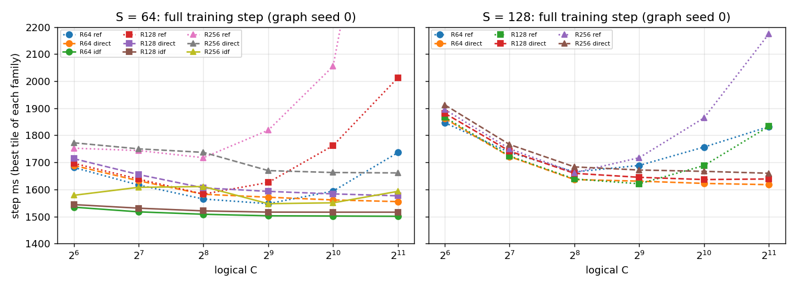
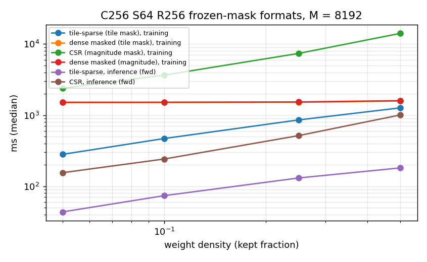
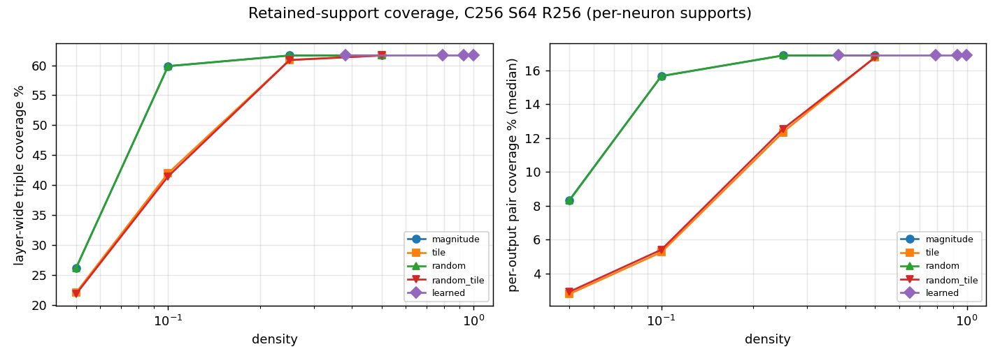

# K64: larger C, index-free S = K execution, and L1 sparsity

Branch `k64-large-c-indexfree-l1` (from `random-kcsr-coverage-sweep` @ `87d89aa`), experiment only: nothing is
merged into `main`. The production defaults, production kernels, and production auto-dispatch are unchanged.
Every new kernel is in the experimental `kgx` bundle, and the dispatcher never selects it. Raw evidence is in
`results/k64_large_c_indexfree_l1/`. The generated tables of every measured row are in
`results/k64_large_c_indexfree_l1/tables.md`, and the CSVs are in `.../csv/`.

## Answers in brief

* **Which C wins at each S/R?** At **S64**, the index-free kernels make every C from 256 to 2048 equally
  fast, within 0.5 %. C64 is about 2 % slower (1.9–2.2 %).
  * Confirmed medians at R256: C2048 1547.6, C512 1552.8, C256 1554.7, C64 1577.0 ms.
  * At R64 and R128, the screen best is C2048 (1500.8 and 1515.9 ms), with C512 and C1024 within 0.1 %.

  At **S128**, small C is clearly worse: C64 is 13–14 % slower than C ≥ 256. Above that, C256 to C2048 are
  within 1.2 % of each other.
  * Best per (S128, R): R64 → C2048 (1617.6 ms); R128 → C512 (1620.8 ms); R256 → C2048 (1659.7 ms).

  The fastest dense step overall is **S64 R64 C2048 idf256 at 1500.8 ms**. That is ×1.12 faster than the
  same-session E24 anchor (K64 C256 S64 R256 on the kgen kernels: 1672–1712 ms), and ×1.16 faster than E04
  (production K8 C64 S128 R64: 1745 ms).

* **Where does the gain come from?** The main factors differ between small and large C.
  * **Index removal (S64, same graph, same weights):** ×1.025–1.059 on the full step, the same at every C.
    This is the `direct` → `idf_rmw` step.
  * **Register-accumulated index-free dX:** a further ×1.021–1.061. This is the `idf_rmw` → `idf` step.
  * **Work distribution at small C:** contributes nothing. `direct` matches the kgen reference within
    ×0.99–1.00 at C ≤ 256.
  * **Work distribution at large C:** dominates. The logical-C lowering to C256 subblocks loses up to 2×
    at C2048 R256 (dX 2.46 s), and direct large-C execution recovers it (×1.99).

  Confirmed against the kgen reference at C256 S64 R256: direct ×0.997, idf_rmw ×1.042, idf ×1.079.

* **Does L1 create useful zeros?** It creates exact zeros, but none of them are useful for execution.
  * Coupled L1 (a subgradient in the moments) makes **no exact zeros** at any strength.
  * Proximal L1 makes exact zeros only at α ≥ 10. Density is 0.929 at α10, 0.790 at α30 and 0.381 at α100.
  * The task penalty after fine-tuning on the synthetic diagnostic is +0.7 %, +1.9 % and +4.6 %.
  * The zeros are completely unstructured. Even at α100, **not a single** 16×16 tile and not a single neuron
    is all-zero. Through CSR, these supports are ×0.06–0.14 the speed of the dense masked step.
* **Which sparse format helps?** The **tile-sparse 16×16 format** improves forward, dX, dW, the optimizer and
  the complete step at every density from 0.5 down, as long as the mask is tile-structured. Speedups on the
  complete training step, against the identical-mask dense model:

  | density | speedup |
  |---:|---:|
  | 0.5 | ×1.25 |
  | 0.25 | ×1.77 |
  | 0.1 | ×3.21 |
  | 0.05 | ×5.37 |

  The 0.1 and 0.05 speedups are confirmed over 3 graph seeds (±0.013 and ±0.025).

  The **CSR (unstructured) format never improves the training step.** Its best result is ×0.63 at density
  0.05. Its forward pass alone (inference) is faster only at density 0.05: ×1.27, or ×1.76 when the mask is
  tile-shaped.
* **What density and setup cost are needed?**
  * Tile wins at density ≤ 0.5. Densities above 0.5 were not measured.
  * One support refresh (U) costs 0.13–0.28 s for tile, which the per-step saving pays back in 0.23–0.40
    steps. L1 itself adds under 0.3 ms per optimizer update.
  * Tile is the only format with a time break-even. **CSR has none**, at any density, because it saves
    nothing per step.
* **What coverage is lost?**
  * Larger C at a fixed S/R does not change S64's layer-wide potential coverage. It cuts per-output pair
    coverage from 52.1 % (C64) to 2.29 % (C2048).
  * At S128, larger C also cuts layer-wide triples: at R256, 98.1 % at C64 versus 73.3 % at C2048.
  * Learned supports keep all potential coverage.
  * Magnitude and random masks at density 0.05 keep 26 % of triples and 0.11 % of quadruples (dense: 61.6 %
    and 5.56 %).
  * Tile masks at density 0.1 keep 42 % of triples. Per output they cut the median pair coverage at C256 from
    16.9 % to 5.3 %, because 66 % of all neurons become bias-only.
* **Which results are only inference, panel or synthetic?** The following are not claims about full
  training: every inference (forward-only) row, the 2:4 panel microbenchmark, the L1 learning and fine-tuning
  runs (a synthetic composed task at M_train = 512), and the refresh amortization arithmetic (measured parts,
  combined).

## 1. Source, provenance and environment

* **Parent:** `random-kcsr-coverage-sweep` @ `87d89aad18b5abebb2eb81d5083ab01d9f3f7689`.
* **Branch:** `k64-large-c-indexfree-l1`. Experiment commits:

  | commit | contents |
  |---|---|
  | `d00c8f2` | kgx kernels, lowering route, L1AdamW, sparse formats, coverage, drivers |
  | `609480a` | learning diagnostic; sparse, refresh, mask-coverage and 2:4 drivers; report generator; sanitizer workload; tests |
  | `c388563` | learned supports for the escalated α values |
  | `317d773` | graph seeds for sparse confirmation; chunked CSR state remap |
  | `f729782` | fine-tune driver, plots, confirmation tables |
  | `99d6be3` | tile-zero analysis |
  | (final commit) | this report and the raw evidence |
* **AGENTS.md:** none exists in the repository. The documentation I read was `docs/architecture.md`,
  `docs/evidence.md`, `docs/validation/`, the previous report and its raw records.
* **Measurement protocol:**
  * Every measurement ran from a frozen, detached worktree (`GranuleLayer-k64l1-meas`), advanced only to
    committed HEADs.
  * All records went to a results root outside any checkout (`GRANULE_RESULTS_ROOT`, new in
    `benchmarks/common.py`) and were copied into this branch afterwards. The source tree under test was never
    modified by its own outputs.
  * Every record carries `provenance` (`benchmarks/provenance.py`):
    * the commit and the full `git status --porcelain --untracked-files=all`;
    * each changed path, classified as source or generated, with separate `source_dirty` and
      `generated_dirty` flags;
    * the source diff when dirty;
    * `source_tree_sha256`;
    * `hardware_state` (driver, pstate, clocks, power, temperature, memory);
    * the build identity (library hashes, flags, nvcc and host compiler);
    * the graph fingerprint and the logical parameter sha;
    * for sparse runs, the mask sha256 and immutable-metadata fingerprints checked before and after the
      timed steps.
* **Every one of the 325 measurement records has `source_dirty: false` and `generated_dirty: false`.**
  The stages ran at different commits:

  | stage | commit |
  |---|---|
  | screen | `d00c8f2` |
  | learn, escalate | `609480a` |
  | sparse, anchors, coverage, mask coverage, 2:4 | `c388563` |
  | refresh (first run, superseded), sparse anchors | `c388563` |
  | refresh2, confirmation | `317d773` |
  | fine-tune | `f729782` |
  | tile zeros | `99d6be3` |

  Between `d00c8f2` and HEAD, the library code changed only additively: the random-tile control mask and the
  dense-checkpoint build kind in `experimental/kgx_sparse.py`. The kernels did not change. The library hashes
  are identical in every record:
  * kgx `8051ededac4ec881e800`;
  * production `e55eb569423be99b2776`;
  * kgen `023754cd60595afae7e9`.

  The production and kgen hashes are byte-identical to the previous study's.
* **Hardware and software:** RTX 3090 (sm_86, 82 SMs, 23.68 GiB, 370 W limit), driver 550, nvcc 12.1.66,
  g++ 11.4, PyTorch 2.7.0+cu128, Triton 3.3, and cuSPARSELt 0.6.3 (bundled with PyTorch; not upgraded).
  One GPU workload ran at a time, and all gates and campaigns ran in `systemd-run --user --scope`.
* **Build flags:** `-O3 --use_fast_math -lineinfo -std=c++17 -arch=sm_86`. Resource usage per kernel is in
  `build/ptxas_resources.json`.

### 1.1 The `dirty: true` discrepancy in the previous confirmation records

The previous report says "`dirty: false` in every record". All 34 of its screen records are `dirty: false`,
but all 33 of its confirmation records are `dirty: true`. The cause can be recovered, with evidence in
`provenance/prev_meas_worktree.diff` and `prev_meas_worktree_status.txt`:

* **What the flag measured:** the old `git_dirty()` was `git status --porcelain --untracked-files=no` of the
  implementation checkout. It flagged any modified tracked file, result files included.
* **What changed:** the frozen measurement checkout (`GranuleLayer-kcsr-meas` @ `dec91ce`) tracked
  `results/random_kcsr_coverage_performance/coverage/X01_s0.json`. The coverage campaign re-ran X01 into that
  same path at 01:49:01. That was after the last screen record (01:44:59) and before the first confirmation
  record (selection.json, 01:49:57).
* **What the diff shows:** that checkout still has exactly one modified tracked path, this JSON.
  * The diff changes only timing fields (`graph_seconds`, `index_seconds`, `exact_seconds`,
    `sampled_seconds`, `analysis_seconds`). It also drops `timing_fingerprint_match`, because the re-run had
    no `--timing-json`.
  * `git diff --name-only HEAD -- '*.py' '*.cu' '*.cuh' '*.sh'` is empty, so no source file differed.

So the confirmation records were measured on unmodified sources at `dec91ce`. The flag reflects a rewritten
generated result file, not a source change. I left the historical records unchanged. The previous report's
sentence is inaccurate for the confirmation records; it should read "source-clean; `dirty: true` caused by a
rewritten tracked coverage JSON". This study's provenance keeps the two cases apart (`source_dirty` versus
`generated_dirty`).

## 2. Support matrix and implementation

| variant (name in records) | what it is | S | C | tiles | status |
|---|---|---|---|---|---|
| `ref` = `kgen` | existing experimental kgen K64 kernels, record-indexed | 64, 128 | ≤ 256 | – | reference |
| `ref` = `lowered` | logical C → physical C256 subblocks on the kgen kernels; views of the same tensors (NB_p = f·NB_l); gradients and state map 1:1 | 64, 128 | 512–2048 | – | reference |
| `direct@T` | new kgx kernel, record-indexed, neuron-tiled items (group, feature block, neuron block, packed record pair) | 64–256 | 16–2048 | 64 / 128 / 256 | experimental |
| `idf_rmw@T` | S = K index-free: a record is the whole feature set (local record indices removed); per-record slab read-modify-write dX | 64 only | 16–2048 | 64 / 128 / 256 | experimental |
| `idf@T` | index-free with register-accumulated dX; warp-private slab copies summed in a fixed order | 64 only | 16–2048 | 64 / 128 / 256 | experimental |
| `tile` (`KgxTileLayer`) | frozen-mask compact 16×16 tiles (per 16-neuron group: a 4-bit mask of kept 16-input blocks plus the first compact tile); tensor cores; skips dropped groups | 64 only | 16–2048 | 64 / 128 / 256 | experimental |
| `csr` (`KgxCsrLayer`) | frozen-mask unstructured: BF16 values, uint8 input index, per-neuron rowptr; CUDA cores; windowed forward and dX, 16 neurons/warp dW | 64 only | 16–2048 | 256 window | experimental |
| 2:4 | `torch.sparse.to_sparse_semi_structured` (cuSPARSELt 0.6.3) | – | – | – | **panel microbenchmark only** |

**Rejected requests.** Each of these raises an error with a stated reason (`backends/dispatch.kgx_reason`,
`kgx_layer`):

* the index-free and sparse variants at S ≠ 64 (S128 records are not the sets);
* `deterministic` reduction (kgx uses FP32 atomics, so no deterministic claim extends to these kernels);
* K ≠ 64;
* C % 16 ≠ 0 or C > 2048;
* non-Mean(ReLU) pooling;
* non-BF16 parameters;
* `kgen` above C256, or `lowered` at or below C256;
* a lowering where logical C is not a multiple of 256;
* a tile format with a non-tile mask.

**Numerics.** BF16 x, W and bias with FP32 accumulation over all 64 products before one ReLU. Backward
recomputes z, uses the split dZ (BF16 hi + lo), and does cross-CTA sums with FP32 atomics. The same scheme as
the kgen reference.

**Bias-only neurons.** A neuron whose 16-neuron group a tile mask drops entirely keeps its bias,
activation and pooling denominator. Forward adds the exact constant `relu(b)/n_g`, and db = `(b > 0)·Σ_t dY`.
There is no renormalization, and no neuron is removed (`test_bias_only_rows_and_partial_groups_exact`).

**L1AdamW** (`experimental/l1.py`, Triton). It is `optim.FusedAdamW` (BF16 moments, stochastic rounding, the
race fix) with a per-group treatment:

* `none`: bitwise equal to FusedAdamW (tested).
* `coupled`: g ← g + μ·sign(w), inside the kernel.
* `prox`: moments see only the data gradient. The candidate
  u = w − η·m̂/(√v̂ + ε) is soft-thresholded **in FP32 before BF16 rounding**:
  w ← sign(u)·max(|u| − η·μ/(√v̂ + ε), 0). Exact zeros survive stochastic rounding.

A frozen mask zeroes the gradient, the value and both moments of inactive elements. The objective is
L = L_task + μ·Σ_valid |w|, with λ_mean = μ·W0 and W0 = 800M valid slots (padding and biases excluded).

**Initialization and outputs.** `granule.init_by_neuron/1` (seed 17) gives every valid neuron the same draw
for every C, so C variants differ only by graph and sharing. Production defaults are unchanged:
`kgen_layer` still rejects C > 256, and the production bundle hash is identical.

## 3. Manifests and correctness gates

* **Architecture manifest:** `benchmarks/k64_cases.py`.
  * 36 cases: K64 × C {64, 128, 256, 512, 1024, 2048} × S {64, 128} × R {64, 128, 256}.
  * D = G = 1024, H = 12.5M (W0 = 800M), M = 8192.
  * Seeds: graph 0 (plus 1 and 2 for confirmation), init 17, input 23.
  * Anchors are labeled separately (`E24`, `E22`, `E04`, `E08`).
* **Supplied predictions:** the companion script and JSON are preserved byte-for-byte in `supplied/` with
  `SHA256SUMS`. Regenerating the JSON with the script reproduces it exactly.
* **Tests:** `tests/test_kgx.py` and `tests/test_k64_coverage.py` (50 collected tests).
  Between them they cover the gates the assignment lists:
  * generator quotas and index-free equivalence;
  * C512–2048 lowering round-trips with partial tails;
  * dense, tile and CSR against FP64 and against the same dense masked model;
  * all-zero, all-one, empty-tile and partial-tile masks;
  * bias-only rows;
  * token tails, full-K cancellation and nonfinite behavior;
  * main_grad accumulation and checkpoint and complete-snapshot round-trips;
  * L1AdamW against FP64, prox zero preservation, and frozen-state behavior;
  * a composed-model training test (frozen mask versus dynamic regrowth, tested separately and not claimed
    equivalent);
  * mask refresh against a fresh dense masked reference;
  * 2:4 masks in both orientations;
  * coverage oracles (distinct neuron masks in a shared record, empty sets, zero-hit samples).
* **Full regression suite at the frozen code (`99d6be3`):** 3066 passed, 32 skipped, 0 failed in 6 min 31 s
  (`tests/full_suite.txt`). That is the previous 3016 plus the 50 new tests; no existing test regressed.
* **Sanitizers.** All four tools pass on the `kgx` workload (`sanitize_kgx_workload.py`, through
  `run_sanitizer.sh`), with results in `sanitizer_kgx/summary.tsv`. The workload covers direct, idf_rmw, idf,
  tile and CSR forward/dX/dW on small shapes with partial tails:
  * memcheck PASS;
  * racecheck PASS;
  * initcheck PASS;
  * synccheck PASS.

## 4. Dense results (all 36 architectures; stage A screen, graph seed 0, 2×2×2 = 8 samples)

All 36 cases and all 42 runs (36 cases plus anchors) were measured: no OOM, timeout or validation failure.
Peak allocated memory is 7.80–7.82 GiB in every case. Every row with all subphases (forward, dX, dW,
backward, optimizer, step, min–max, memory, items per CTA) is in `tables.md` → "Dense screen", with the CSV in
`csv/dense_screen_variants.csv`. The best step per (S, R) in ms:

| S | R | C64 | C128 | C256 | C512 | C1024 | C2048 |
|---|---|---:|---:|---:|---:|---:|---:|
| 64 | 64 | 1,534.4 idf | 1,517.2 idf | 1,508.3 idf | 1,502.6 idf | 1,501.8 idf | **1,500.8** idf256 |
| 64 | 128 | 1,544.0 idf | 1,530.8 idf | 1,520.7 idf | 1,516.2 idf | 1,516.0 idf | **1,515.9** idf256 |
| 64 | 256 | 1,578.3 idf | 1,607.8 idf | 1,610.6 idf | **1,547.2** idf128 | 1,550.6 idf | 1,593.0 idf |
| 128 | 64 | 1,846.6 ref | 1,721.4 direct | 1,636.3 direct | 1,630.6 direct | 1,622.2 direct | **1,617.6** direct256 |
| 128 | 128 | 1,866.7 ref | 1,723.4 ref | 1,638.6 ref | **1,620.8** ref (lowered) | 1,636.4 direct | 1,638.6 direct |
| 128 | 256 | 1,895.4 ref | 1,750.2 ref | 1,662.0 ref | 1,671.7 direct | 1,666.8 direct | **1,659.7** direct256 |

**Screen and confirmation disagree on three S64 R256 values.** The screen R256 values for C128/C256/C2048
(about 1590–1610) were noisier (min–max spreads up to 20–40 ms). Confirmation (§8, 24 samples × 3 graphs)
puts C256 at 1554.7 and C2048 at 1547.6. C ≥ 256 at S64 R256 is a tie within 0.5 %.



### 4.1 S64 attribution on identical tensors (same graph, weights, inputs and state)

| C | ref → direct (work distribution) | direct → idf_rmw (index removal) | idf_rmw → idf (register dX) |
|---|---|---|---|
| 64 | ×0.989–0.996 | ×1.056–1.059 | ×1.043–1.061 |
| 128 | ×0.990–0.996 | ×1.050–1.054 | ×1.021–1.036 |
| 256 | ×0.986–0.989 | ×1.044–1.050 | ×1.021–1.028 |
| 512 | ×0.985–1.089 | ×1.040 | ×1.023–1.038 |
| 1024 | ×1.021–1.236 | ×1.032–1.034 | ×1.025–1.037 |
| 2048 | ×1.116–1.996 | ×1.025–1.029 | ×1.025–1.039 |

**Where the time goes, by phase.** At C256 R256, removing indexing saves forward time (direct128 231 → 212 ms)
and dW (618 → 586 ms). Register accumulation saves dX (836 → 789 ms).

**Why lowering loses at large C.** Each logical record becomes f = C/256 physical records, each with its own
gather and dX reduction. At C2048 R256 the lowered dX is 2,462 ms against 821 ms for direct256. That is the
×2 of "better work distribution". The physical neuron tile matters by ≤ 3.2 % for idf. At S128, where no
index-free path exists, the best direct tile is within ×0.985–1.036 of the reference at C ≤ 512 and beats it
by ×1.03–1.31 at C ≥ 1024.

**Coverage at S128.** Larger C also reduces the number of distinct records there (§7), so S128 step changes
across C are not attributed to execution alone.

### 4.2 Anchors (same session; E24 first, middle and last)

| | E24 (K64/C256/S64/R256, kgen) | E22 (K64/C64/S128/R32) | E04 (production K8/C64/S128/R64) | E08 (K16/C16/S128/R256) |
|---|---|---|---|---|
| screen | 1,712.0 / 1,672.3 / 1,675.6 | 1,854.4 | 1,745.0 | 3,310.3 |
| confirmation | 1,710.6 / 1,677.3 / 1,676.4 | – | 1,745.0 | – |

The first E24 run in each session is about 2 % slower, which is the warm-up of a fresh session. The middle and
last E24 runs agree with the matched `ref` of K64_C256_S64_R256 (1,676.9 in confirmation).

## 5. L1 learning diagnostic (stage B; synthetic; M_train = 512)

**Setup.**
* Full W0 = 800M, C ∈ {64, 256, 2048}, S64 R256.
* Composed model: a 256 → 1024 projection, the layer, and a 64-way head, regressed onto a fixed random teacher
  (seed 31).
* Schedule: 32 warm-up updates, then 96 regularized updates (16-step linear μ ramp), then 32 fixed-mask
  fine-tuning updates. η_layer = 1e-4.

**Calibration.** μ = α·g_ref, where g_ref is the median |g| of 1M sampled valid task gradients at step 32. It
is **g_ref ≈ 1.70e-9 at every C**. That is below Adam's ε = 1e-8, so updates are ε-damped. The prox
threshold per step is then about η·μ/ε. The planned α ∈ {0, 0.1, 1, 10} produced zeros only at α10, so the
capped escalation added α30 and α100 (two extra strengths, 96 regularized updates each).

| C | treatment | α | λ_mean | density after L1 (exact nonzero) | mean active fan-in | held-out: warm-up → after L1 → fine-tuned | all-zero neurons | optimizer ms/step |
|---|---|---:|---:|---:|---:|---|---:|---:|
| 256 | prox | 0 | 0 | 1.0000 | 64.00 | 0.26542 → 0.25557 → 0.24723 | 0 | 19.48 |
| 256 | prox | 0.1 | 0.136 | 1.0000 | 64.00 | → 0.25558 → 0.24724 | 0 | 19.49 |
| 256 | prox | 1 | 1.36 | 0.9977 | 63.85 | → 0.25564 → 0.24733 | 0 | 19.48 |
| 256 | prox | 10 | 13.6 | 0.9294 | 59.48 | → 0.25639 → 0.24891 | 0 | 19.48 |
| 256 | prox | 30 | 40.8 | 0.7905 | 50.59 | → 0.25783 → 0.25204 | 0 | 19.51 |
| 256 | prox | 100 | 136 | 0.3810 | 24.38 | → 0.26052 → 0.25868 | 0 | 19.50 |
| 256 | coupled | 0.1 / 1 / 10 | 0.136 / 1.36 / 13.6 | 1.0000 / 1.0000 / 1.0000 | 64.00 | → 0.25558 / 0.25577 / 0.25960 → 0.24724 / 0.24765 / 0.25639 | 0 | 19.49 |

**Results.**
* C64 and C2048 give the same densities within 0.001 (`tables.md`).
* Coupled L1 shrinks weights (|w| ≤ 1e-3 fraction 0.046 at α10) but makes no exact zeros. It also costs more
  loss than prox at the same α: 0.25639 against 0.24891.
* Proximal zeros are dynamic: weights leave and re-enter the support (`test_proximal_support_is_dynamic`).

**Structure of the learned zeros** (`tilezeros/tilezeros.json`). In the α0, α10, α30 and α100 checkpoints
(C256, and C2048 α100), **all 3,125,248 non-padding 16×16 tiles and all 12.5M neurons hold at least one
nonzero**. Learned L1 sparsity is element-level only, so the tile format cannot use it.

**Fixed-mask fine-tuning of pruned α0 checkpoints** (C256; 32 updates with fresh optimizer state; synthetic).
Held-out loss: checkpoint → pruned → fine-tuned. The dense control continued for the same 32 updates reaches
0.25023.

| density | magnitude | tile | random | random tile |
|---:|---|---|---|---|
| 0.5 | 0.2565 → 0.2533 | 0.2739 → 0.2572 | 0.2732 → 0.2577 | 0.2765 → 0.2576 |
| 0.25 | 0.2616 → 0.2561 | 0.3104 → 0.2608 | 0.3006 → 0.2611 | 0.3148 → 0.2611 |
| 0.1 | 0.2788 → 0.2596 | 0.3577 → 0.2634 | 0.3361 → 0.2633 | 0.3613 → 0.2636 |
| 0.05 | 0.2987 → 0.2614 | 0.3808 → 0.2642 | 0.3590 → 0.2642 | 0.3834 → 0.2645 |

On this task, after fine-tuning, a magnitude-ranked tile mask is no better than a random tile mask, and
element-wise magnitude pruning loses the least. This is a diagnostic of the implementation and the update
rules, **not a downstream-accuracy result**.

## 6. Frozen-mask sparse execution (M = 8192, full H; same values, mask and state as the dense masked model)

**What the comparison holds fixed.** Every comparison loads one checkpoint (C256 α0 after 128 updates), builds
one mask, and runs both the dense masked model (dense kgx idf128 kernels, `L1AdamW` with the mask) and the
compact format, with identical values, biases and optimizer state. The mask sha256 matches in every pair.

**What each step includes.** Training steps include forward, backward and the optimizer. The compact formats
update their compact values directly, so nothing is ever repacked or left stale.

**Executed work** (record `execution.work_lists` / `index_bytes`). Tile at density 0.05 runs 156,262 of
3,125,248 tiles and 144,760 of 781,312 16-neuron groups, with one launch per phase. At density 0.5 it runs
1,562,624 tiles. CSR runs exactly nnz products (40M at density 0.05).

### 6.1 C256 screen, training step (ms, median of 8)

| mask / format | density | fwd | dX | dW | opt | step | vs identical-mask dense masked | peak GiB | values + metadata |
|---|---:|---:|---:|---:|---:|---:|---:|---:|---:|
| dense (L1 none, no mask) | 1 | 212.0 | 782.1 | 586.1 | 19.7 | 1,603.5 | – | 7.80 | 1.6 GB |
| tile mask / dense masked | 0.5 | 206.2 | 772.4 | 577.9 | 20.7 | 1,581.9 | – | 8.55 | |
| tile mask / **tile** | 0.5 | 183.1 | 619.9 | 453.4 | 9.8 | 1,265.9 | **×1.25** | 4.04 | 766 MB |
| tile mask / **tile** | 0.25 | 131.8 | 451.0 | 266.7 | 5.1 | 856.9 | **×1.77** | 2.27 | 384 MB |
| tile mask / **tile** | 0.1 | 74.8 | 265.4 | 124.8 | 2.2 | 469.1 | **×3.22** | 1.28 | 156 MB |
| tile mask / **tile** | 0.05 | 44.3 | 165.1 | 68.5 | 1.3 | 280.7 | **×5.36** | 0.96 | 79 MB |
| random tiles / tile | 0.05 | 44.1 | 165.8 | 68.7 | 1.3 | 282.9 | (same speed as magnitude tiles) | 0.96 | 79 MB |
| magnitude / csr | 0.5 | 1,004.5 | 8,279.7 | 4,838.7 | 9.8 | 14,133.8 | ×0.11 | 4.47 | 1,192 MB |
| magnitude / csr | 0.25 | 513.1 | 4,343.2 | 2,517.7 | 5.1 | 7,385.4 | ×0.21 | 2.41 | 620 MB |
| magnitude / csr | 0.1 | 246.9 | 2,228.9 | 1,178.2 | 2.2 | 3,658.4 | ×0.42 | 1.17 | 277 MB |
| magnitude / csr | 0.05 | 152.4 | 1,522.3 | 714.4 | 1.3 | 2,390.8 | ×0.63 | 0.76 | 162 MB |
| tile mask / csr | 0.05 | 108.8 | 861.0 | 646.7 | 1.3 | 1,619.8 | ×0.93 | 1.04 | 162 MB |
| learned prox α10 / csr | 0.929 | 1,767.7 | 14,339 | 8,327 | 25.8 | 24,459 | ×0.06 | 8.01 | 2,175 MB |
| learned prox α100 / csr | 0.381 | 756.7 | 6,255 | 3,670 | 10.8 | 10,694 | ×0.14 | 3.49 | 920 MB |

**Random controls.** Random element masks run at the same CSR speed as magnitude masks (×0.12, 0.21, 0.42 and
0.63), and random tiles at the same tile speed as magnitude tiles.

**The dense + L1 treatment costs** 1,603.5 (none), 1,604.9 (coupled) and 1,607.5 (prox) ms per step. The
optimizer itself differs by under 0.3 ms; the rest is run-to-run variation.

**Inference (forward only, compressed checkpoint):**

| format and mask | ×speedup at density 0.5 / 0.25 / 0.1 / 0.05 |
|---|---|
| tile | ×1.14 / ×1.53 / ×2.66 / ×4.47 (181 → 44 ms) |
| CSR, magnitude mask | ×0.21 / ×0.39 / ×0.82 / **×1.27** |
| CSR, tile-shaped mask | ×1.76 at 0.05 |



**Which phase benefits.** For tile, every phase does. At density 0.05: forward ×4.4, dX ×4.5, dW ×8.0,
optimizer ×16. For CSR, the forward pass alone helps at 0.05; dX and dW always regress, ×0.49 and ×0.78 at
0.05. CSR runs on CUDA cores with uint8 index gathers. In the CSR dX kernel, every nonzero performs one
shared-memory gather and one FP32 accumulate per token, and these CUDA-core products cannot keep up with the
tensor-core dense products at any measured density. This is a well-supported negative result for unstructured training at these densities.

**The dense masked baseline speeds up as density drops.** Its step goes from 1,603.5 ms (dense) to
1,506–1,533 ms (density ≤ 0.25) with the same kernels, so zero operands speed up dense tensor-core work. The
recorded SM clocks are consistent with lower power at higher zero fractions (1,845–1,875 MHz against
1,815–1,830 MHz). These are single samples per round, so they do not prove the cause. Every sparse speedup
here is measured against this faster identical-mask baseline, which makes it conservative compared with the
unmasked dense step.

### 6.2 Anchors C64 and C2048

The C64 and C2048 anchors at densities 0.25, 0.1 and 0.05 reproduce C256 (`tables.md` → "sparse_anchors"):

* tile 0.05: ×5.28 (C64) and ×5.44 (C2048);
* tile 0.1: ×3.18 (C64) and ×3.24 (C2048);
* tile 0.25: ×1.77 (C2048);
* CSR: ×0.21–0.64.

### 6.3 Maintenance, refresh and amortization (C256, full size, outside the timed steps)

**Components of U** (seconds, median of 3; `refresh2/`): select, compress, work lists, and optimizer-state
remap. Densifying back to the dense layout is listed separately.

| format | density | select | compress | work lists | state remap | **U** | densify |
|---|---:|---:|---:|---:|---:|---:|---:|
| tile | 0.5 / 0.25 / 0.1 / 0.05 | 0.02 | 0.00 | 0.10 / 0.14 / 0.23 / 0.26 | ≤ 0.01 | **0.13 / 0.16 / 0.25 / 0.28** | 0.01 |
| csr | 0.5 / 0.25 / 0.1 / 0.05 | 0.18–0.19 | 0.04–0.08 | 0.08–0.10 | 0.03–0.07 | **0.44 / 0.39 / 0.34 / 0.33** | 0.01–0.03 |

**History of these numbers.** The first refresh run (`refresh/`) went out of memory at CSR density 0.5,
because the whole-tensor state remap materializes 12 GB. That run is kept and marked `SUPERSEDED.txt`. The
remap is now chunked, and all eight jobs were re-measured into `refresh2/`.

**Amortized step**, combining the measured parts arithmetically:
* Periodic reselection (reselects among stored values; no regrowth): s + U/T.
* Dynamic regrowth (charges one dense step for dense candidate gradients at each refresh):
  ((T − 1)·s + dense + U)/T.

| format | density | ordinary step | periodic T = 1 / 16 / 128 | dynamic T = 1 / 16 / 128 | identical-mask dense masked | break-even (steps to repay U) |
|---|---:|---:|---|---|---:|---|
| tile | 0.5 | 1,265.9 | 1,392 / 1,274 / 1,267 | 1,730 / 1,295 / 1,270 | 1,581.9 | 0.40 |
| tile | 0.25 | 856.9 | 1,020 / 867 / 858 | 1,766 / 914 / 864 | 1,516.1 | 0.25 |
| tile | 0.1 | 469.1 | 716 / 485 / 471 | 1,851 / 555 / 480 | 1,510.1 | 0.24 |
| tile | 0.05 | 280.7 | 560 / 298 / 283 | 1,883 / 381 / 293 | 1,506.0 | 0.23 |
| csr | 0.05–0.5 | 2,391–14,134 | always slower than dense | always slower | 1,517–1,598 | **none: no per-step saving** |

**Setup cost.** Building the sparse model from a dense checkpoint is one U, which tile repays within one step.
The prox L1 phase adds under 0.3 ms per optimizer update (19.48–19.51 ms against 19.48 ms at α0), so it is
nearly free. Its supports do not feed the tile format (§5), so for tile it also buys nothing. Dynamic regrowth with T = 1 is slower than dense for every
format.

## 7. Coverage

**Method** (`k64_coverage.py`, `Supports`: per-neuron 64-bit input masks):
* Pairs and triples are exact, via membership matmuls.
* Quadruples use a fixed 10M sample, or 50M at ≥ 90 % sparsity, with Clopper–Pearson 95 % CIs. The sampling
  seed is in each record.
* Per output: features for all 1024 outputs; pairs, triples and quadruples on ≥ 32 selected outputs.
* Dense coverage is measured on the timed graphs; the graph fingerprint matches the timing record.

**Dense potential coverage.** All 36 cases match the supplied model within its CIs (`tables.md` → "Dense
potential coverage"). Summary:

| | C64 | C256 | C2048 |
|---|---:|---:|---:|
| S64 R256: layer-wide triples / quadruples | 61.64 % / 5.56 % | same | same |
| S64: per-output features (median; of 1024) | 1024 | 978 | 329 |
| S64: per-output pairs (median; bound) | 52.1 % (73.5) | 16.9 % (18.5) | 2.29 % (2.31) |
| S128 R256: layer-wide triples / quadruples | 98.07 % / 38.05 % | 97.79 % / 31.28 % | 73.32 % / 7.89 % |

* At S64, every record is a whole set, so layer-wide coverage depends only on R. Larger C changes only how
  many outputs share each record, so the per-output loss is the price of C. At S128, larger C also removes
  distinct records.

**Retained coverage after pruning** (C256 S64 R256; layer-wide triple / quadruple %; per-output pair median %):

| mask | density 0.5 | 0.25 | 0.1 | 0.05 |
|---|---|---|---|---|
| learned prox (α1 / α10 / α30 / α100) | **61.64 / 5.56 / 16.9 at every α**: no tuple is lost | | | |
| magnitude | 61.64 / 5.56 / 16.9 | 61.64 / 5.56 / 16.9 | 59.86 / 1.49 / 15.7 | 26.20 / 0.108 / 8.34 |
| random | 61.64 / 5.56 / 16.9 | 61.64 / 5.56 / 16.9 | 59.86 / 1.49 / 15.7 | 26.19 / 0.107 / 8.31 |
| tile | 61.64 / 5.56 / 16.8 | 60.90 / 5.14 / 12.3 | 41.99 / 2.15 / 5.26 | 22.08 / 0.82 / 2.79 |
| random tile | 61.64 / 5.56 / 16.8 | 60.87 / 5.13 / 12.5 | 41.46 / 2.10 / 5.41 | 21.83 / 0.80 / 2.92 |

* **Element masks** spread their losses: no neuron becomes bias-only above density 0.1, about 15k do at 0.1,
  and 470k at 0.05.
  They keep per-output pair coverage longest.
* **Tile masks** turn whole 16-neuron groups into bias-only neurons: 0.79M, 3.96M, 8.21M and 10.18M of 12.5M
  at the four densities. The per-output median feature count drops from 978 to 838 at 0.05.
* **Tile masks keep more quadruples than element masks** at density ≤ 0.1 (0.82 % against 0.108 % at 0.05),
  because the surviving tiles keep complete 16-input blocks.
* At C2048 the same pattern holds. Tile at 0.05 cuts per-output pairs from 2.29 % to 0.99 %.
* An exact-nonzero threshold of |w| > 0.01 on α0 (density 0.936) loses nothing.



## 8. Stage C confirmation (graph seeds 0 / 1 / 2; 4 × 2 × 3 = 24 samples per seed)

**Selection.** The criteria and the selection were saved before any confirmation run
(`confirm_selection.json`): ≤ 8 architectures covering C512, C1024, C2048, both S, a small-C anchor and the
highest-coverage cases, plus four sparse combinations. All 56 runs were measured.

**Statistics.** The paired ratio is reference step over variant step on the same graph and parameters, for
each seed. The mean ± t₉₅ is taken over the 3 graph seeds; within-run samples are not treated as independent
graphs.

| case | ref | best direct | idf_rmw | idf | idf vs ref (± 95 %) |
|---|---:|---:|---:|---:|---|
| C64 S64 R256 | 1,755.8 | 1,775.7 (×0.989) | 1,675.4 (×1.048) | 1,577.0 | **×1.113 ± 0.003** |
| C256 S64 R256 | 1,676.9 | 1,681.6 (×0.997) | 1,609.2 (×1.042) | 1,554.7 | **×1.079 ± 0.003** |
| C512 S64 R256 | 1,821.0 (lowered) | 1,676.3 (×1.086) | 1,610.0 (×1.131) | 1,552.8 | **×1.173 ± 0.006** |
| C2048 S64 R64 | 1,738.6 (lowered) | 1,557.6 (×1.116) | 1,538.3 (×1.130) | 1,501.7 | **×1.158 ± 0.003** |
| C2048 S64 R256 | 3,212.1 (lowered) | 1,614.3 (×1.990) | 1,602.8 (×2.004) | 1,547.6 | **×2.076 ± 0.002** |
| C64 S128 R256 | 1,895.6 | 1,910.6 (×0.992) | – | – | – |
| C1024 S128 R256 | 1,864.1 (lowered) | 1,666.8 (×1.118 ± 0.004) | – | – | – |
| C2048 S128 R64 | 1,835.5 (lowered) | 1,622.7 (×1.131 ± 0.000) | – | – | – |

Seed-to-seed standard deviations are 0.1–5 ms.

**Sparse confirmation.** The identical-mask dense masked model is the control, at the same checkpoint and
graph-seed graph. Seeds 1 and 2 use α0 checkpoints learned on those graphs.

| combination | speedup per seed | mean ± 95 % |
|---|---|---|
| C256 tile 0.1 | ×3.212 / ×3.202 / ×3.204 | **×3.206 ± 0.013** |
| C256 tile 0.05 | ×5.360 / ×5.379 / ×5.373 | **×5.371 ± 0.025** |
| C2048 tile 0.25 | ×1.777 / ×1.782 / ×1.778 | **×1.779 ± 0.006** |
| C256 magnitude 0.05 CSR | ×0.633 / ×0.633 / ×0.633 | ×0.633 ± 0.001 |

**Against the best dense route.** Compared with the best dense index-free step at the same architecture
(C256 idf128, 1,554.7 ms), tile 0.05 (280.2 ms) is ×5.55 faster and tile 0.1 (470.3 ms) is ×3.31 faster. The
speed comes with the coverage (§7) and task costs (§5) of those masks.

## 9. Ampere 2:4 (feasibility audit and panel microbenchmark only; `semi24/panel.json`)

**What the audit found.** cuSPARSELt 0.6.3 (version code 603) is available in the installed PyTorch;
`to_sparse_semi_structured` works for BF16 on sm_86. Both operand orientations compress and are correct
(max relative error about 3e-3 against the dense masked product).

**The orientation problem.** A mask that is 2:4 along the 64 inputs, as the forward pass needs, violates 2:4
along the neurons, as dX needs, in 31 % of the neuron quads. A bidirectional 4×4 pattern (90 patterns) meets
both, at a magnitude cost: it keeps 70.2 % of |w|, against 74.4 % for input-direction 2:4.

**Panel speed.** On one record panel (X [8192, 64] × W [C, 64], 64 panels per call), the sparse GEMM is 12–30×
**slower** than dense: 36–41 ms against 1.2–3.4 ms per 64 panels. The K = 64 reduction is too short for the
library kernels. Weight 2:4 also cannot help dW, which never multiplies by W.

No training or layer measurement uses 2:4.

## 10. Limitations

* **Synthetic diagnostics.** The learning and fine-tuning results come from a synthetic composed task at
  M_train = 512, on graph seed 0 (seeds 1 and 2 only for the α0 confirmation checkpoints). g_ref sits below
  Adam's ε, so the effective prox threshold is about η·μ/ε, and the α scale is specific to this regime.
* **Untested densities and tile shapes.** Tile was measured only at densities ≤ 0.5 and with 16×16 tiles. Its
  break-even density in (0.5, 1) is not measured.
* **The CSR kernels are a working baseline.** I tuned them with windows, but a faster unstructured kernel
  might exist. The negative result applies to these kernels on this GPU.
* **The dense-masked clock caveat** of §6.1.
* **The first anchor in each session** is about 2 % slow.
* **Arithmetic, not measured schedules.** The refresh amortization combines measured parts; no full
  refresh-schedule run was measured.
* **2:4** is a panel microbenchmark only.

## 11. Raw evidence and reproduction

All raw evidence is under `results/k64_large_c_indexfree_l1/`:

| path | contents |
|---|---|
| `screen/` | 42 records plus logs |
| `confirm/`, `confirm_sparse/` | confirmation records |
| `learn/`, `escalate/` | learning runs; their checkpoints are not in git (below) |
| `finetune/` | fine-tuning runs |
| `sparse_c256/`, `sparse_anchors/` | sparse timing |
| `refresh2/` | refresh measurements; `refresh/` is superseded |
| `coverage/`, `maskcov/` | coverage records |
| `tilezeros/` | tile-zero analysis |
| `semi24/` | 2:4 panel |
| `sanitizer_kgx/` | sanitizer logs and summary |
| `tests/` | the full regression suite output |
| `csv/`, `tables.md`, `plots/` | generated by `k64_report.py` and `k64_plots.py` |
| `checkpoints/` | each checkpoint's JSON sidecar (spec, step, config, calibration, weight sha256) |

The checkpoints themselves (1.7 GB each, 41 GB total) are kept outside git. They are deterministic:
`k64_learn.py` with the recorded seeds regenerates them, and each one's weight sha256 is recorded in its
sidecar.

**Reproduction commands.** Run them from `sparse_pooling/benchmarks` with
`export GRANULE_RESULTS_ROOT=<dir outside the checkout>`:

```bash
PY=python  # PyTorch 2.7 env
# dense case (reference + direct tiles), S128
$PY bench_supergroups.py --hidden 12500000 --C 2048 --S 128 --R 64 --graph-seed 0 --init-seed 17 --input-seed 23 \
  --rounds 4 --reps 2 --iters 3 --kcsr --layer-factory k64_factory:kgx --factory-args '{"variant": "direct", "tile": 256}' \
  --layer-variants 'ref=lowered,direct256=direct@256' --out repro/C2048_S128_R64
# index-free case with its indexed controls on the same tensors
$PY bench_supergroups.py --hidden 12500000 --C 256 --S 64 --R 256 --graph-seed 0 --init-seed 17 --input-seed 23 \
  --rounds 4 --reps 2 --iters 3 --kcsr --layer-factory k64_factory:kgx --factory-args '{"variant": "direct", "tile": 256}' \
  --layer-variants 'ref=kgen,direct128=direct@128,idf_rmw128=idf_rmw@128,idf128=idf@128' --out repro/C256_S64_R256
# whole stages
$PY k64_campaign.py screen --out screen
$PY k64_campaign.py coverage --out coverage
$PY k64_jobs.py learn --out learn --ckpt-dir $CK            # alpha 0 / 0.1 / 1 / 10, prox + coupled
$PY k64_jobs.py escalate --out escalate --ckpt-dir $CK      # alpha 30 / 100
$PY k64_jobs.py sparse --out sparse_c256 --ckpt-dir $CK --C 256
$PY k64_jobs.py anchors --out sparse_anchors --ckpt-dir $CK --densities 0.25,0.1,0.05
$PY k64_jobs.py refresh --out refresh2 --ckpt-dir $CK --C 256
$PY k64_jobs.py maskcov --out maskcov --ckpt-dir $CK
$PY k64_jobs.py finetune --out finetune --ckpt-dir $CK --C 256
$PY k64_semi24.py --out $GRANULE_RESULTS_ROOT/semi24/panel.json
$PY k64_campaign.py confirm --out confirm --selection confirm_selection.json
$PY k64_jobs.py plan --plan-file confirm_sparse_plan.json --out confirm_sparse --ckpt-dir $CK
$PY k64_report.py --raw $GRANULE_RESULTS_ROOT && $PY k64_plots.py --raw $GRANULE_RESULTS_ROOT
# one sparse training candidate (tile, density 0.05, from the alpha 0 checkpoint); csr: "format": "csr", "mask": "magnitude"
$PY bench_supergroups.py --hidden 12500000 --C 256 --S 64 --R 256 --graph-seed 0 --init-seed 17 --input-seed 23 \
  --rounds 4 --reps 2 --iters 3 --kcsr --layer-factory k64_factory:sparse \
  --factory-args '{"checkpoint": "'$CK'/C256_R256_prox_a0_step128.pt", "format": "tile", "mask": "tile", "density": 0.05, "mask_seed": 0}' \
  --opt-factory k64_opt:l1 --opt-args '{"l1": "none"}' --out repro/C256_tile_d0.05
# tests and sanitizers
(cd ../tests && $PY -m pytest -q test_kgx.py test_k64_coverage.py)
bash run_sanitizer.sh kgx
```

The `$CK` checkpoint for these commands comes from
`k64_learn.py --C 256 --treatment prox --alpha 0 --ckpt-dir $CK --out ...`.
