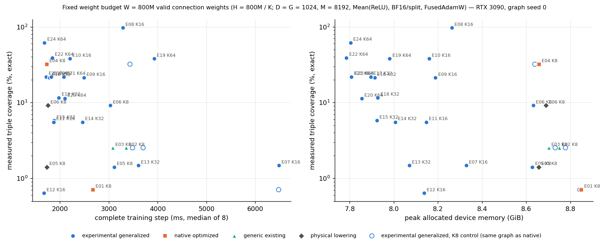
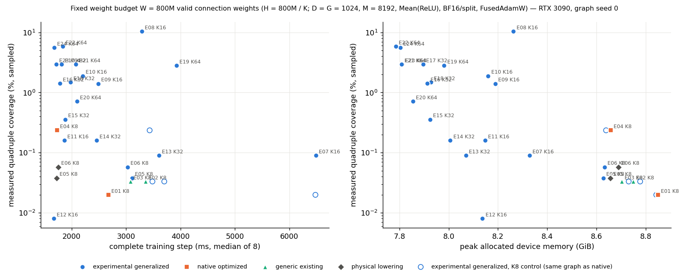

# Random K/C/S/R sweep: feature-combination coverage and training cost at a fixed weight budget

Branch `random-kcsr-coverage-sweep` (experimental; not merged into main). Raw evidence:
[`random_kcsr_coverage_performance/`](random_kcsr_coverage_performance/). Generated tables:
[`tables.md`](random_kcsr_coverage_performance/tables.md), CSV summaries in `csv/`, plots in `plots/`.

## 0. Answers

**Which configurations improve actual feature coverage at acceptable cost?** Measured coverage is set almost
entirely by the supergroup geometry (S, R), not by K or C. In 20 of the 24 graphs the valid records cover every
pair and every triple their realized sets can hold: measured record coverage equals the realized group coverage
exactly. The cheapest high-coverage rows are all large-S / high-R, large-C, large-K graphs on the
experimental backend:

| ID | K | C | S | R | triples (exact) | quadruples (sampled, 95 % CI) | step, 3 seeds (ms) | backend |
|---|---:|---:|---:|---:|---:|---|---:|---|
| E24 | 64 | 256 | 64 | 256 | 61.64 % | 5.558 % [5.544, 5.572] | 1,687 ± 37 | experimental generalized |
| E22 | 64 | 64 | 128 | 32 | 38.97 % | 5.828 % [5.813, 5.842] | 1,867 ± 37 | experimental generalized |
| E17 | 32 | 128 | 128 | 16 | 21.87 % | 2.938 % [2.928, 2.949] | 1,827 ± 8 | experimental generalized |
| E08 | 16 | 16 | 128 | 256 | 97.35 % | 10.425 % [10.406, 10.444] | 3,314 ± 37 | experimental generalized |
| E04 | 8 | 64 | 128 | 64 | 32.12 % | 0.235 % [0.232, 0.238] | 1,744 ± 20 | native (production) |
| E01 | 8 | 8 | 32 | 8 | 0.709 % | 0.020 % [0.019, 0.021] | 2,691 ± 2 | native (production) |

(± = 95 % t-interval over graph seeds 0/1/2.) E24 reaches 87× the triple coverage of E01 at 0.63× its step time.
E08 is the only row with near-complete triple coverage (97 %); it costs 2× E24 in the experimental backend. At
K = 8, E04 (C = 64, S = 128) is the best existing-implementation row: 32 % triples at 1.74 s.

**Which K/C effects are intrinsic under a fixed weight budget?**
* Coverage: K and C act only through the number and size of the records inside each realized set. Once records
  saturate the sets (records per set ≫ C(S, t) / C(K, t)), more records add nothing. The K = S rows
  (E12, E14, E19, E20, E24) have one distinct record per supergroup (every record is the whole set), so C
  changes execution reuse but never within-set diversity. E02 = E03, E11 = E14, E07 = E13 and E21 = E23 have
  identical coverage because they share (S, R, seed) and saturate. Where a row is not saturated, a larger K at the
  same S and R adds tuples per record: E09 (K16) and E16 (K32), both S64 / R64, have equal (saturated) triples, but
  E09 stays just below the quadruple bound (1.400 % vs 1.418 %) and E16 reaches it.
* Memory: per-neuron state scales with H = W / K. Peak allocation falls from 8.85 GiB (K = 8) to 7.8 GiB
  (K = 64), and bias + its main_grad / moments shrink 8×. Index bytes scale with the number of records
  (H / C × K × 2 B), from 191 MiB (C = 8) to 6 MiB (C = 256).
* Time (within one backend): at fixed W the projection MACs are constant, but each logical record is gathered,
  recomputed and scattered once per token tile. dX scatter work is records × K × M = W × M / C. It falls with C
  and does not depend on K. Per-neuron work (activation, dZ, bias) falls with K. The experimental-backend rows are
  consistent with both, although S and R also differ between them: across the K16 rows the step goes 6.5 → 3.3 →
  2.5 → 2.2 → 1.9 → 1.7 s from C = 8 to 256, and at C = 256 it goes 3.0 s (K8) → 1.7 s (K16, K64) and 2.0 s
  (K32).

**Which differences remain confounded by backend implementation?** Every K > 8 timing comes from the untuned
experimental backend, which is 1.1–2.5× slower than the production kernels on the same K = 8 graphs: ×2.39 at
C = 8 (E01, ±0.01 over three seeds), ×1.98 at C = 64 (E04), ×1.10 / ×1.13 at C = 16 / 32 (where production runs
generic kernels), ×1.80 / ×1.73 at logical C = 128 / 256 (vs. the physical lowering). So "K64 is faster than
native K8" is **not** an architecture result. Against the matched experimental K = 8 rows, K = 64 at C ≥ 64 saves
40–50 %; against the production K = 8 kernels, E24 (1.69 s) and E04 (1.74 s) are equal within error. The E07
outlier (K16 C8: 6.5 s, dX 4.7 s) is a tiling artifact: its dX slab copies do not fit warp-private and are
shared through CAS. E13 / E19 (same C, private copies) run dX in about half the time. Each row also has its own
S and R (the random design), so per-axis effects in the screen are not controlled single-factor comparisons.

No GPU number in this report comes from the analytical CSVs. Coverage is a structural statistic; nothing here
measures downstream model quality.

## 1. Source, environment, build identity

* Implementation base: `main` @ `0d748ae` (merge of `gpu-portability-cleanup` incl. `c75c402`, `fd99c2d`,
  `e16b88a`: capability / profile / build separation, strict sanitizer runner). The E01–E04 / X01 "unchanged code"
  rows ran on a pristine detached checkout of that commit (`screen/native/`, `commit 0d748aea`, clean).
* Experiment commits: code `a63b3ab`; measurement runs `dec91ce` (clean, `dirty: false` in every record) from a
  frozen worktree, so development never touched a running measurement.
* Production library `e55eb569423be99b2776` in both the pristine and the experiment runs: the extension does not
  change the production bundle. Experimental bundle `kgen` `023754cd60595afae7e9`.
* RTX 3090 (sm_86, 82 SMs, 23.68 GiB usable, 370 W limit), driver 550.67, nvcc 12.1.66, PyTorch 2.7.0+cu128 (CUDA
  12.8 runtime), Triton 3.3.0; profile `rtx3090` (hardware-validated) for every production phase.
* Budget and semantics: D = G = 1024, M = 8192 tokens, Mean(ReLU), BF16 inputs / weights, FP32 accumulation and
  main_grad, `grad_precision = "split"`, FusedAdamW (BF16 moments, stochastic rounding, with the `eab9f59` race fix),
  lr 1e-4. Weights N(0, 1 / K) (std 1 / √K, the production rule), bias zeros (`bias_std = 0`, all K). Graph seed 0
  (confirmation: 0, 1, 2), init seed 17, input seed 23.

| K | H (valid neurons) | valid weights | biases |
|---:|---:|---:|---:|
| 8 | 100,000,000 | 800,000,000 | 100,000,000 |
| 16 | 50,000,000 | 800,000,000 | 50,000,000 |
| 32 | 25,000,000 | 800,000,000 | 25,000,000 |
| 64 | 12,500,000 | 800,000,000 | 12,500,000 |

Physical padding differs per (C, layout): allocated weight bytes are 1,526–1,536 MiB (section 6). The comparison is
equal in **valid connection weights**, not in total parameters.

## 2. The random manifest and the supplied predictions

The four supplied files are in `random_kcsr_coverage_performance/supplied/`, unchanged (sha256:
W800M CSV `2dc5f622…`, H100M CSV `fa14ccbc…`, manifest `fcde3461…`, script `adaf2dab…`). Re-running the script
(`repro/`) passes its self-tests (accepted attempt 17, 546 legal tuples, enumeration checks) and reproduces both
CSVs and the manifest exactly. `benchmarks/kcsr_cases.py` reads the 24 cases from the manifest and re-runs the
sampler to assert them. The control X01 (K8 / C8 / S64 / R16) is labelled separately everywhere and is not one of
the 24.

The supplied prediction columns appear unchanged next to the measurements in section 5 and in `csv/coverage.csv`.

## 3. Support and extension matrix

Audit of the unchanged implementation (`audit/support_audit_base_0d748ae.json`): E01–E04 accepted;
E05 / E06 `SparseLayout: block (shared_neurons) must be 8, 16, 32 or 64`; E07–E24 `SparseLayout: kernels are
specialised for fan-in 8`. Execution of each measured row (from `last_info["execution"]`):

| Rows | Representation | Kernels actually run | Numerical scheme | Status |
|---|---|---|---|---|
| E01, X01 | native K8, C8 | grouped fwd / dX / dW (dX scatter `vectorized_transpose_hoisted` E01, `swizzle4_capped` X01) | production split | existing-supported |
| E02, E03 | native K8, C16 / C32 | generic fwd / dX / dW (grouped C8 / C64 only) | production split | existing-supported |
| E04 | native K8, C64 | grouped fwd, generic dX / dW (auto: S128 has no grouped C64 dX / dW entry) | production split | existing-supported |
| E05, E06 | logical K8 C128 / C256 → physical C64 (2 / 4 sub-blocks, index records duplicated 2× / 4×) | production grouped fwd, generic dX / dW | production split | extension-validated (lowering) |
| E05, E06 (common backend) | logical C128 / C256 in the experimental backend | kgen | kgen split (below) | extension-validated |
| E07–E24 | logical K16 / 32 / 64, C 8–256 | kgen | kgen split | extension-validated |
| E01–E04, X01 (K8 control) | the **same graph and parameters** as the native rows (fingerprints equal) | kgen | kgen split | extension-validated |

No row ended unsupported, OOM, timed out or failed validation. The 73 timing runs are all `measured`
(`screen/campaign/status.jsonl`, `confirm/status.jsonl`).

## 4. The extensions

### 4.1 Generalized generator (`sparse_pooling/experimental/kgen_graph.py`)
This is a parameterization of `supergroups.generate_indices`, not a new process. It keeps the R global
partitions (`make_feature_sets`, unchanged), the balanced quotas with round-interleaved extras, and the
per-supergroup stream of local permutation passes, but cuts each pass into S / K disjoint K-records instead of
S / 8, and makes the assignment quantum a parameter. With K = 8 and the production quantum (4 / 2 / 1 / 1 blocks
at C = 8 / 16 / 32 / 64) it reproduces the production indices, feature sets and buckets **bit for bit**, including
the full H = 100M X01 graph (`tests/test_kgen.py`). Change for the extended rows: quantum = 1 logical record, so
the assignment balances individual records and no assignment unit holds invalid records. A production C8 / C16
unit can (E01 / X01: 768 invalid record slots in 1.56M local passes). Structural validation (every valid block in
exactly one bucket; K distinct, sorted, in-set indices; every feature in exactly R sets; Σ valid neurons = H) runs
on every timed graph before timing.

### 4.2 Logical C = 128 / 256 by physical lowering (`experimental/lowering.py`)
Logical block j becomes the f = C / 64 physical C64 blocks f·j … f·j + f − 1 carrying the same record. In canonical
storage this is a reshape, so neuron ids (slot = j·C + c), output membership, bias, padding, main_grad and AdamW
state map one to one. Physical buckets are the logical buckets scaled by f, the last one per output trimmed to its
valid physical blocks. A physical unit (one C64 block) never mixes supergroups, and the copies of a record always
share its supergroup. Tests: forward / dX / dW / db against float64; physical main_grad ↔ logical; `unlower` round
trip; checkpoint round trip; partial logical tails of ≤ 64 / 65–128 / > 192 valid neurons; production
`validate()` of the physical graph. The lowered and the experimental C128 / 256 layers have identical graph
fingerprints and logical-parameter hashes. Coverage is measured on logical records (duplicated copies counted
once).

### 4.3 Experimental generalized-fan-in kernels (bundle `kgen`, `kernels/cuda/experimental/kgen/`)
These are three grouped kernels, templated on K, with C a runtime multiple of 8 up to 256. They reuse the
production staging swizzle, ldmatrix / mma / movmatrix primitives, BF16 split and the generic dZ expression.

* forward: CTA = (token tile, chunk of one supergroup); the S rows of X staged in shared memory; each record's K
  inputs gathered by ldmatrix.trans; **z accumulates all K / 16 m16n8k16 tiles (one m16n8k8 at K = 8) before the
  single activation**; one FP32 atomic per (token, bucket) into the [G, B] sum.
* dX: recompute z, dZ = c1 · act′(z) (dZ as BF16 hi + lo, "split"), dA = dZ Wᵀ (Wᵀ by movmatrix), accumulated over
  the block's 16-neuron groups, added into FP32 slab copies (warp-private where they fit, else 64-bit CAS shared by
  2–4 warps), one FP32 atomic per (feature, token) per CTA.
* dW / db: per 16-neuron task zᵀ = W Xᵀ, dZᵀ, dWᵀ = dZᵀ X (hi + lo), register accumulators over all tokens,
  exclusive ownership, one plain write-back.
* Tilings are fixed per K (`sp_kg_config`, recorded per run): forward MT 4 / 4 / 4 / 2 (K 8 / 16 / 32 / 64), dX MT
  4 / 4 / 2 / 2, dW tasks per warp 8 / 4 / 2 / 1, 8 warps, dW ring 2 tiles × 3 stages. There is no tuning profile.
  Legality (`backends/dispatch.kgen_reason`) raises for anything else: other poolings, deterministic reduction,
  B % 8 ≠ 0, K > S, C > 256.
* Numerics: the same operand scheme as the production "split" path (BF16 operands, FP32 accumulation, dZ as
  hi + lo). Summation orders differ (C-group order in dA, CTA chunking, atomics), so results are not bitwise equal
  to production. Measured agreement: within 3e-6 relative of float64 (split; 2e-3 BF16), the production level.
* Not implemented: deterministic mode (explicitly unsupported), poolings other than Mean(ReLU / identity),
  specialised epilogues. dZ always uses the production generic expression, so non-finite coefficients produce
  the same NaN / inf patterns as the production kernels on the same graph (tested).

### 4.4 Correctness gate (before any reported timing)
* `tests/test_kgen.py` (73) and `tests/test_kcsr_coverage.py` (12): generator equivalence; float64 reference over 14
  (K, C, S, R) shapes × ReLU / identity incl. ragged H, partial C blocks, C % 16 = 8 tails, token tails (B = 8 … 520),
  split and BF16; cancellation to exactly zero and near-zero pre-activations; full-K activation decisions (partial
  K8 sums of the opposite sign; the K8-split model would be active, the layer is not); the matched K8 control
  vs production on four (C, S, R) graphs in both precisions; non-finite / huge / subnormal / zero-boundary
  coefficients vs production (identical NaN / inf masks); lowering (above); main_grad accumulation over three
  backward calls; FusedAdamW (first / second moments, step counter, main_grad cleared, padded weights stay 0);
  checkpoint round trip and graph-spec mismatch refusal; unsupported requests; a composed model Linear → kgen →
  Linear → MSE whose step-1 upstream gradient matches float64 (3e-5) and whose loss falls over 30 FusedAdamW steps
  for K = 16 / 64 / 8 (C256).
* The full suite: 3016 passed, 32 skipped (6 min 20 s), including the existing production tests: nothing regressed.
* Compute Sanitizer, `run_sanitizer.sh … kgen` (`sanitizer_kgen_final/`: memcheck, racecheck, initcheck,
  synccheck), separate from timing. The workload covers every K, C = 8 / 24 / 136 / 256, S = 16–128, private / pair /
  CTA-shared dX copies, both precisions and activations, token tails, inf / NaN coefficients, and the lowered
  C128 / C256 layers on the production kernels. All four tools PASS (0 errors, 0 race hazards, 64 forward + backward
  calls each). `sanitizer_kgen/` holds the first run, before the lowered layers were added to the workload; it also
  passed.
* Within-backend repeatability: the experimental backend is fast-mode only (FP32 atomics), so bitwise repeatability
  is not claimed. Run-to-run agreement of outputs is < 1e-6 relative (checkpoint tests).

## 5. Coverage on the actual graphs

Analyzer `benchmarks/kcsr_coverage.py`. It regenerates the timed graph (same generator, seeds, code) and asserts
the logical-graph fingerprint of the timing run: all 73 timing records match their coverage record. Layer-wide,
over all unordered t-tuples of D = 1024 (523,776 pairs, 178,433,024 triples, 45,545,029,376 quadruples):

* pairs and triples **exact**: per supergroup, the distinct valid logical records as a 0/1 matrix M; covered local
  pairs = MᵀM > 0, triples = (M∘M)ᵀM > 0 (BF16 0/1 operands, FP32 accumulation), written into 1M- and 178M-byte
  global bitmaps. There is no occurrence list.
* quadruples **sampled**: one fixed seeded sequence of distinct uniform quadruples (seed 20261023), identical for
  every graph. A query finds the realized sets containing all four features, then ANDs per-supergroup record
  bitsets. The sample is 10M, doubled while there are fewer than 1,000 hits (E12: 20M). Intervals are 95 %
  Clopper–Pearson. A 1M-triple sample of the same machinery brackets the exact triple value in every graph.
* analysis: 5–17 s and < 4.3 GiB per graph, run in separate processes after timing.
* validated against a set-based oracle on tiny graphs (generated, K = S, repeated records, empty supergroups,
  partial C tails with padded neurons excluded, physical lowering).

Three distinct quantities per tuple order:

| ID | K | C | S | R | t | supplied model (pre-experiment) | refined model (graph metadata) | **measured** | realized group (upper bound) | supplied group expectation |
|---|---:|---:|---:|---:|---|---:|---:|---:|---:|---:|
| E01 | 8 | 8 | 32 | 8 | pair / triple / quad | 21.8213 / 0.7094 / 0.0202 | 21.8213 / 0.7094 / 0.0202 | 21.8246 / 0.7094 / 0.0199 [0.0190, 0.0208] | 21.8246 / 0.7094 / 0.0199 | 21.8213 / 0.7094 / 0.0202 |
| E02 | 8 | 16 | 16 | 128 | | 84.9038 / 2.5385 / 0.0327 | same | 85.0228 / 2.5390 / 0.0331 [0.0320, 0.0343] | 85.0228 / 2.5390 / 0.0331 | 84.9038 / 2.5385 / 0.0327 |
| E03 | 8 | 32 | 16 | 128 | | 84.9038 / 2.5385 / 0.0327 | same | 85.0228 / 2.5390 / 0.0331 [0.0320, 0.0343] | 85.0228 / 2.5390 / 0.0331 | 84.9038 / 2.5385 / 0.0327 |
| E04 | 8 | 64 | 128 | 64 | | 99.9793 / 32.1163 / 0.2375 | same | 99.9801 / 32.1187 / 0.2352 [0.2322, 0.2382] | 99.9801 / 62.7522 / 11.3247 | 99.9793 / 62.7354 / 11.3113 |
| E05 | 8 | 128 | 32 | 16 | | 38.8809 / 1.4138 / 0.0384 | same | 38.8811 / 1.4139 / 0.0377 [0.0365, 0.0389] | 38.8811 / 1.4139 / 0.0398 | 38.8809 / 1.4138 / 0.0404 |
| E06 | 8 | 256 | 32 | 256 | | 99.9447 / 9.2049 / 0.0576 | same | 99.9444 / 9.2038 / 0.0576 [0.0562, 0.0591] | 99.9628 / 20.3736 / 0.6462 | 99.9621 / 20.3731 / 0.6447 |
| E07 | 16 | 8 | 64 | 4 | | 22.4499 / 1.4860 / 0.0893 | same | 22.4743 / 1.4863 / 0.0894 [0.0875, 0.0913] | 22.4743 / 1.4863 / 0.0894 | 22.4499 / 1.4860 / 0.0893 |
| E08 | 16 | 16 | 128 | 256 | | 100.0000 / 97.3444 / 10.4204 | same | 100.0000 / 97.3457 / 10.4250 [10.4060, 10.4439] | 100.0000 / 98.0725 / 38.1429 | 100.0000 / 98.0716 / 38.1311 |
| E09 | 16 | 32 | 64 | 64 | | 98.2887 / 21.3019 / 1.4012 | same | 98.2808 / 21.2989 / 1.4001 [1.3928, 1.4074] | 98.2808 / 21.2989 / 1.4176 | 98.2887 / 21.3019 / 1.4185 |
| E10 | 16 | 64 | 64 | 128 | | 99.9707 / 37.9130 / 1.8873 | same | 99.9693 / 37.9112 / 1.8834 [1.8750, 1.8918] | 99.9693 / 38.0638 / 2.8148 | 99.9707 / 38.0661 / 2.8169 |
| E11 | 16 | 128 | 32 | 64 | | 86.0458 / 5.5363 / 0.1616 | same | 86.0471 / 5.5362 / 0.1599 [0.1575, 0.1624] | 86.0471 / 5.5362 / 0.1599 | 86.0458 / 5.5363 / 0.1616 |
| E12 | 16 | 256 | 16 | 32 | | 37.6672 / 0.6408 / 0.0082 | same | 37.7524 / 0.6408 / 0.0080 [0.0076, 0.0084] | 37.7524 / 0.6408 / 0.0080 | 37.6672 / 0.6408 / 0.0082 |
| E13 | 32 | 8 | 64 | 4 | | 22.4499 / 1.4860 / 0.0893 | same | 22.4743 / 1.4863 / 0.0894 [0.0875, 0.0913] | 22.4743 / 1.4863 / 0.0894 | 22.4499 / 1.4860 / 0.0893 |
| E14 | 32 | 16 | 32 | 64 | | 86.0458 / 5.5363 / 0.1616 | same | 86.0471 / 5.5362 / 0.1599 [0.1575, 0.1624] | 86.0471 / 5.5362 / 0.1599 | 86.0458 / 5.5363 / 0.1616 |
| E15 | 32 | 32 | 64 | 16 | | 63.8316 / 5.8130 / 0.3565 | same | 63.8844 / 5.8135 / 0.3557 [0.3520, 0.3594] | 63.8844 / 5.8135 / 0.3557 | 63.8316 / 5.8130 / 0.3565 |
| E16 | 32 | 64 | 64 | 64 | | 98.2887 / 21.3019 / 1.4185 | same | 98.2808 / 21.2989 / 1.4176 [1.4103, 1.4249] | 98.2808 / 21.2989 / 1.4176 | 98.2887 / 21.3019 / 1.4185 |
| E17 | 32 | 128 | 128 | 16 | | 88.0073 / 21.8689 / 2.9401 | same | 88.0605 / 21.8731 / 2.9384 [2.9279, 2.9489] | 88.0605 / 21.8731 / 2.9550 | 88.0073 / 21.8689 / 2.9564 |
| E18 | 32 | 256 | 128 | 8 | | 65.3695 / 11.6082 / 1.4812 | same | 65.4142 / 11.6128 / 1.4774 [1.4700, 1.4849] | 65.4142 / 11.6128 / 1.4857 | 65.3695 / 11.6082 / 1.4893 |
| E19 | 64 | 8 | 64 | 128 | | 99.9707 / 38.0661 / 2.8169 | same | 99.9693 / 38.0638 / 2.8148 [2.8046, 2.8251] | 99.9693 / 38.0638 / 2.8148 | 99.9707 / 38.0661 / 2.8169 |
| E20 | 64 | 16 | 64 | 32 | | 86.9185 / 11.2880 / 0.7118 | same | 87.0160 / 11.2906 / 0.7109 [0.7057, 0.7161] | 87.0160 / 11.2906 / 0.7109 | 86.9185 / 11.2880 / 0.7118 |
| E21 | 64 | 32 | 128 | 16 | | 88.0073 / 21.8689 / 2.9564 | same | 88.0605 / 21.8731 / 2.9550 [2.9445, 2.9655] | 88.0605 / 21.8731 / 2.9550 | 88.0073 / 21.8689 / 2.9564 |
| E22 | 64 | 64 | 128 | 32 | | 98.5617 / 38.9553 / 5.8253 | same | 98.5841 / 38.9709 / 5.8278 [5.8133, 5.8424] | 98.5841 / 38.9709 / 5.8278 | 98.5617 / 38.9553 / 5.8253 |
| E23 | 64 | 128 | 128 | 16 | | 88.0073 / 21.8689 / 2.9564 | same | 88.0605 / 21.8731 / 2.9550 [2.9445, 2.9655] | 88.0605 / 21.8731 / 2.9550 | 88.0073 / 21.8689 / 2.9564 |
| E24 | 64 | 256 | 64 | 256 | | 100.0000 / 61.6419 / 5.5545 | same | 100.0000 / 61.6360 / 5.5578 [5.5436, 5.5720] | 100.0000 / 61.6360 / 5.5578 | 100.0000 / 61.6419 / 5.5545 |
| X01 | 8 | 8 | 64 | 16 | (control) | – | 63.8316 / 5.8130 / 0.3549 | 63.8844 / 5.8135 / 0.3543 [0.3506, 0.3580] | 63.8844 / 5.8135 / 0.3557 | – |

(Graph seed 0; percentages; pairs and triples exact, quadruples sampled with 95 % CI. Seeds 1 / 2 of the confirmed
cases: `tables.md`, all within the seed-0 intervals' scale, e.g. E08 quadruples 10.425 / 10.433 / 10.431 %.)

Reading:
* The supplied finite-record model is accurate for these graphs: every measured quadruple CI contains or nearly
  touches it. Exact pairs / triples deviate by ≤ 0.12 percentage points, which is the realization of the R
  random partitions (the realized group coverage moves by the same amount).
* The refined prediction uses the actual valid records of every local pass (`local_pass_table`). It equals the
  supplied model to 4 decimals for all 24 graphs. Its implementation reproduces the supplied script's `predict()`
  to 1e-9 when no pass has invalid records (test). The 768 invalid slots of the native C8 graphs (E01, X01) are
  too few to show.
* "Saturated" rows (measured = realized group for pairs and triples) are E01–E03, E05, E07, E09, E11–E24. Only
  E04, E06, E08 and E10 have records that do not fill their sets (e.g. E04 triples 32.1 % of a 62.8 % bound).
  This is where K, C and the number of records still matter. Elsewhere only S and R matter.
* K = S rows have one distinct record per supergroup (E12, E14: 2,048; E19: 2,048; E20: 512; E24: 4,096 distinct of
  49K–1.56M records). Additional local permutations create no new index sets, and C changes only how often the set
  is reused.

## 6. Performance: screen of all 24 cases (graph seed 0)

Protocol (`bench_supergroups.py`, unchanged timing protocol): fresh process per run; two warm-up steps; complete
training-state capture in pinned host memory (parameters, main_grad, AdamW moments and steps, the stochastic-
rounding counter, RNG states); per round one untimed step, then two repetitions, each restored from the snapshot
(fingerprint-verified outside the timed region, ≥ 4 checks per run) and timed for two full steps with CUDA events.
That gives 2 rounds × 2 repetitions × 2 steps = 8 samples per phase, all kept in the JSON (`samples_ms`) with both
round medians. The order is a seeded shuffle with X01 native baselines first, middle and last.

Full per-phase table (forward layout / zero / kernel / finalize, backward coefficients / layout / dX init / dX /
dW / post, optimizer, step, step min–max, host enqueue, step wall, peaks, first step, coverage) for every run:
`tables.md` and `csv/timing_runs.csv`. The primary rows:

| ID | K | C | S | R | backend (class) | fwd | dX | dW | bwd | opt | **step** (min–max) | peak GiB | triple % | quad % |
|---|---:|---:|---:|---:|---|---:|---:|---:|---:|---:|---|---:|---:|---:|
| E01 | 8 | 8 | 32 | 8 | native (optimized, grouped) | 314 | 1,256 | 1,083 | 2,340 | 21 | 2,676 (2,666–2,684) | 8.85 | 0.709 | 0.0199 |
| E02 | 8 | 16 | 16 | 128 | native (generic existing) | 362 | 1,369 | 1,600 | 2,971 | 21 | 3,356 (3,340–3,367) | 8.75 | 2.539 | 0.0331 |
| E03 | 8 | 32 | 16 | 128 | native (generic existing) | 374 | 1,117 | 1,567 | 2,686 | 21 | 3,082 (3,072–3,092) | 8.70 | 2.539 | 0.0331 |
| E04 | 8 | 64 | 128 | 64 | native (grouped fwd, generic dX/dW) | 271 | 714 | 724 | 1,440 | 21 | 1,733 (1,725–1,739) | 8.66 | 32.119 | 0.2352 |
| E05 | 8 | 128 | 32 | 16 | physical lowering → C64 | 271 | 712 | 720 | 1,434 | 21 | 1,728 (1,718–1,731) | 8.66 | 1.414 | 0.0377 |
| E06 | 8 | 256 | 32 | 256 | physical lowering → C64 | 272 | 734 | 725 | 1,460 | 21 | 1,754 (1,745–1,764) | 8.69 | 9.204 | 0.0576 |
| E07 | 16 | 8 | 64 | 4 | experimental | 381 | 4,655 | 1,432 | 6,087 | 20 | 6,488 (6,485–6,522) | 8.33 | 1.486 | 0.0894 |
| E08 | 16 | 16 | 128 | 256 | experimental | 364 | 2,028 | 875 | 2,904 | 20 | 3,288 (3,284–3,295) | 8.26 | 97.346 | 10.4250 |
| E09 | 16 | 32 | 64 | 64 | experimental | 283 | 1,388 | 797 | 2,185 | 20 | 2,489 (2,484–2,494) | 8.19 | 21.299 | 1.4001 |
| E10 | 16 | 64 | 64 | 128 | experimental | 256 | 1,149 | 777 | 1,928 | 20 | 2,203 (2,199–2,209) | 8.16 | 37.911 | 1.8834 |
| E11 | 16 | 128 | 32 | 64 | experimental | 232 | 881 | 732 | 1,614 | 20 | 1,867 (1,865–1,871) | 8.15 | 5.536 | 0.1599 |
| E12 | 16 | 256 | 16 | 32 | experimental | 221 | 734 | 697 | 1,432 | 20 | 1,673 (1,669–1,675) | 8.14 | 0.641 | 0.0080 |
| E13 | 32 | 8 | 64 | 4 | experimental | 284 | 2,100 | 1,201 | 3,302 | 20 | 3,605 (3,599–3,612) | 8.07 | 1.486 | 0.0894 |
| E14 | 32 | 16 | 32 | 64 | experimental | 290 | 1,527 | 621 | 2,148 | 20 | 2,460 (2,451–2,467) | 8.01 | 5.536 | 0.1599 |
| E15 | 32 | 32 | 64 | 16 | experimental | 217 | 1,010 | 632 | 1,643 | 20 | 1,880 (1,876–1,884) | 7.92 | 5.814 | 0.3557 |
| E16 | 32 | 64 | 64 | 64 | experimental | 214 | 905 | 640 | 1,546 | 20 | 1,782 (1,778–1,784) | 7.91 | 21.299 | 1.4176 |
| E17 | 32 | 128 | 128 | 16 | experimental | 200 | 924 | 673 | 1,598 | 20 | 1,818 (1,813–1,821) | 7.90 | 21.873 | 2.9384 |
| E18 | 32 | 256 | 128 | 8 | experimental | 207 | 1,071 | 678 | 1,750 | 20 | 1,977 (1,965–1,990) | 7.93 | 11.613 | 1.4774 |
| E19 | 64 | 8 | 64 | 128 | experimental | 434 | 2,241 | 1,234 | 3,476 | 19 | 3,928 (3,920–3,937) | 7.98 | 38.064 | 2.8148 |
| E20 | 64 | 16 | 64 | 32 | experimental | 296 | 1,160 | 622 | 1,782 | 19 | 2,098 (2,093–2,101) | 7.85 | 11.291 | 0.7109 |
| E21 | 64 | 32 | 128 | 16 | experimental | 260 | 1,165 | 636 | 1,802 | 19 | 2,080 (2,077–2,087) | 7.81 | 21.873 | 2.9550 |
| E22 | 64 | 64 | 128 | 32 | experimental | 233 | 949 | 637 | 1,587 | 19 | 1,839 (1,837–1,843) | 7.79 | 38.971 | 5.8278 |
| E23 | 64 | 128 | 128 | 16 | experimental | 223 | 841 | 633 | 1,474 | 19 | 1,718 (1,712–1,726) | 7.81 | 21.873 | 2.9550 |
| E24 | 64 | 256 | 64 | 256 | experimental | 215 | 845 | 604 | 1,450 | 19 | 1,682 (1,671–1,690) | 7.80 | 61.636 | 5.5578 |

(ms, median of 8 samples; "fwd" / "bwd" are the inclusive forward / backward intervals, "dX" / "dW" the kernel
intervals inside the backward, so dX + dW + coefficient / layout / post ≈ bwd. Activation recomputation happens
inside dX and dW and is not timed separately.)

Common-backend rows (the experimental backend on K = 8):

| ID | C | same graph as | experimental step | production / lowered step | ratio |
|---|---:|---|---:|---:|---:|
| E01 | 8 | native E01 | 6,480 | 2,676 | 2.42 |
| X01 | 8 | native X01 | 7,708 | 3,058 | 2.52 |
| E02 | 16 | native E02 (generic) | 3,703 | 3,356 | 1.10 |
| E03 | 32 | native E03 (generic) | 3,485 | 3,082 | 1.13 |
| E04 | 64 | native E04 | 3,434 | 1,733 | 1.98 |
| E05 | 128 | lowered E05 | 3,108 | 1,728 | 1.80 |
| E06 | 256 | lowered E06 | 3,027 | 1,754 | 1.73 |

The overhead is concentrated in dX and dW. At C = 8 it comes from half-empty 16-neuron dW tasks, a single n8
tile per record and CAS-shared dX slab copies where private copies do not fit. At C = 64–256 the production dW
uses indexed staging and tuned tilings. The experimental forward is 1.3–1.5× slower throughout. The physical
lowering costs nothing measurable relative to native C64: E05 / E06 at 1.73–1.75 s ≈ E04 at 1.73 s, despite 2× /
4× duplicated index records (24 MiB instead of 12 / 6 MiB).

Memory, construction and host (screen; MiB unless noted; full table in `csv/timing_runs.csv`):

| ID | backend | bias | indices | main_grad | Adam (BF16) | graph meta KiB | work lists | peak alloc GiB | peak reserved GiB | step scratch | graph gen s | first step s | host enqueue ms |
|---|---|---:|---:|---:|---:|---:|---:|---:|---:|---:|---:|---:|---:|
| E01 | native | 191 | 191 | 3,434 | 3,434 | 4,112 | 20.2 | 8.85 | 11.13 | 240 | 0.2 | 2.75 | 1.5 |
| E02 | native | 191 | 95 | 3,434 | 3,434 | 49,088 | 0 | 8.75 | 10.29 | 208 | 3.7 | 3.63 | 1.5 |
| E04 | native | 191 | 24 | 3,438 | 3,438 | 8,320 | 6.0 | 8.66 | 11.38 | 208 | 0.3 | 1.89 | 1.5 |
| E06 | lowered | 191 | 24 | 3,438 | 3,438 | 6,624 | 9.1 | 8.69 | 9.11 | 240 | 3.8 | 1.98 | 1.5 |
| E08 | experimental | 95 | 95 | 3,243 | 3,243 | 33,280 | 49.0 | 8.26 | 9.23 | 161 | 1.1 | 3.29 | 1.3 |
| E12 | experimental | 96 | 6 | 3,247 | 3,247 | 3,120 | 27.2 | 8.14 | 8.19 | 160 | 1.0 | 1.69 | 1.3 |
| E17 | experimental | 48 | 12 | 3,152 | 3,152 | 2,080 | 14.5 | 7.90 | 7.92 | 161 | 0.2 | 1.83 | 1.3 |
| E22 | experimental | 24 | 24 | 3,104 | 3,104 | 3,120 | 9.3 | 7.79 | 7.87 | 160 | 0.2 | 1.85 | 1.3 |
| E24 | experimental | 24 | 6 | 3,120 | 3,120 | 1,280 | 7.7 | 7.80 | 7.84 | 160 | 1.8 | 1.69 | 1.3 |

Weights are 1,526–1,536 MiB in every row (800M valid + padding). Host snapshots (≈ 8.5 GB pinned) are benchmark
overhead and are not charged to any row. Clocks 1,650–1,830 MHz, ≤ 56 °C, 333–349 W during the timed rounds
(`gpu_rounds` per record). Session drift: X01 native 3,058 / 3,058 / 3,046 ms (screen) and 3,085 / 3,063 / 3,065 ms
(confirmation), i.e. ≤ 1.3 % within a campaign. The earlier pristine-main session measured 3,133 / 3,151 ms
(+2.5 %): compare rows within a campaign, not across sessions.




(Pair coverage: `plots/coverage_pair_vs_step.png`. Colour and marker encode the execution class; hollow circles
are the experimental K8 controls on the native graphs.)

## 7. Confirmation (at most eight cases, selected from the screen)

Selection (`confirm/selection.json`, decided from the seed-0 screen and coverage, not by replacing the random
sample):
* frontier: E12 (fastest), E24 (triples vs time), E22 (quadruples vs time), E08 (highest coverage);
* one per K: E04 and E01 (K8, with matched production / experimental controls), E17 (K32);
* surprising regression: E07.

Protocol: graph seeds 0 / 1 / 2, 4 rounds × 2 restored repetitions × 3 steps (24 samples per run), fresh processes,
seeded order, X01 baselines first / middle / last. All 33 runs were measured.

| ID | K | C | S | R | backend | step per seed (ms) | mean ± 95 % CI (t, n = 3) | dX | dW | triple % per seed | quad % per seed |
|---|---:|---:|---:|---:|---|---|---|---:|---:|---|---|
| E01 | 8 | 8 | 32 | 8 | native | 2,691.6 / 2,691.1 / 2,689.8 | 2,690.9 ± 2.3 | 1,261 | 1,088 | 0.709 / 0.709 / 0.709 | 0.0199 / 0.0207 / 0.0200 |
| E01 | 8 | 8 | 32 | 8 | experimental (K8 control) | 6,449.0 / 6,443.9 / 6,390.9 | 6,427.9 ± 79.9 | 2,953 | 2,976 | same graph | same graph |
| E04 | 8 | 64 | 128 | 64 | native | 1,741.9 / 1,753.2 / 1,738.0 | 1,744.3 ± 19.6 | 718 | 730 | 32.119 / 32.112 / 32.114 | 0.2352 / 0.2382 / 0.2382 |
| E04 | 8 | 64 | 128 | 64 | experimental (K8 control) | 3,445.5 / 3,445.0 / 3,444.1 | 3,444.8 ± 1.7 | 1,424 | 1,644 | same graph | same graph |
| E07 | 16 | 8 | 64 | 4 | experimental | 6,503.8 / 6,619.5 / 6,501.2 | 6,541.5 ± 167.9 | 4,701 | 1,443 | 1.486 / 1.486 / 1.486 | 0.0894 / 0.0890 / 0.0901 |
| E08 | 16 | 16 | 128 | 256 | experimental | 3,330.9 / 3,305.5 / 3,304.6 | 3,313.6 ± 37.1 | 2,044 | 881 | 97.346 / 97.350 / 97.349 | 10.425 / 10.433 / 10.431 |
| E12 | 16 | 256 | 16 | 32 | experimental | 1,678.3 / 1,692.0 / 1,678.1 | 1,682.8 ± 19.8 | 736 | 704 | 0.641 / 0.641 / 0.641 | 0.0080 / 0.0082 / 0.0082 |
| E17 | 32 | 128 | 128 | 16 | experimental | 1,824.9 / 1,825.4 / 1,830.6 | 1,826.9 ± 7.8 | 927 | 678 | 21.873 / 21.864 / 21.865 | 2.938 / 2.944 / 2.941 |
| E22 | 64 | 64 | 128 | 32 | experimental | 1,881.5 / 1,868.9 / 1,851.8 | 1,867.4 ± 37.0 | 965 | 642 | 38.971 / 38.947 / 38.944 | 5.828 / 5.832 / 5.820 |
| E24 | 64 | 256 | 64 | 256 | experimental | 1,690.2 / 1,699.5 / 1,670.4 | 1,686.7 ± 36.9 | 848 | 602 | 61.636 / 61.650 / 61.641 | 5.558 / 5.553 / 5.567 |

Paired matched controls (same graph and parameters per seed), experimental / production step: E01 2.396 / 2.394 /
2.376 (mean 2.389), E04 1.978 / 1.965 / 1.982 (mean 1.975). The screen ranking is confirmed: every confirmed mean
is within 2 % of its seed-0 screen value. The seed-to-seed standard deviation of the step is ≤ 1.0 % of the mean
for every confirmed row.
Seed-to-seed spread of coverage is small next to the differences between cases (triples ±0.01 points).

Whole-step differences that survive the uncertainty:
* E24 vs E22 (same backend, both K64): E24 is 10 % faster (1,687 vs 1,867 ± 37 ms) with 1.6× the triple
  coverage and 0.95× the quadruple coverage.
* E24 (experimental) vs E04 (production, K8): equal step within error (1,687 ± 37 vs 1,744 ± 20). E24 has 1.9×
  the triples and 24× the quadruples. Backend maturity favours E04 by ~2× (matched control), so the architecture
  comparison at equal backend maturity is open (section 8).
* E08: the only near-complete triple coverage; 1.96× the step of E24 in the same backend.

## 8. Fixed-W conclusions and the separate fixed-H theory

**Fixed W = 800M valid weights (measured):**
1. Coverage is decided by (S, R). Doubling S at a given R (or raising R at a given S) moves pair / triple coverage
   by tens of points. K and C move it only where the records do not already saturate the realized sets (E04, E06,
   E08, E10 here). Choosing K ≤ S, C, S, R to stay saturated, and spending the budget on S and R instead, is the
   lever.
2. Under the fixed budget, larger C reduces record count, index memory and per-record gather / scatter work
   (dX ∝ W·M / C). Larger K reduces neurons (H = W / K), and with them per-neuron state (bias, activation, dZ) and
   peak memory (8.85 → 7.8 GiB). Neither changes the projection MAC count.
3. In the backend that can run all K, the fastest high-coverage configurations are K ≥ 32 with C ≥ 64 (1.68–1.87 s;
   E24 61.6 % triples). C = 8 is slow for every K in this backend (3.6–6.5 s): a backend weakness that the matched
   C8 control shows is largest exactly there (×2.4).
4. With the production kernels only (K = 8), the best configuration is E04-like (C64, S128, R64: 32 % triples at
   1.73 s). Logical C = 128 / 256 by physical lowering runs at the same cost as C64 (1.73–1.75 s) and is a valid way
   to use larger C without new kernels.

**Confounded / open:** the absolute K > 8 step times include an experimental-backend penalty that is only measured
at K = 8 (×1.1–2.5 depending on C and on which production path is the reference). How that penalty scales with K
is unknown without a tuned K > 8 implementation. A K-generic version of the production tilings (indexed dW
staging, warp-private dX for small C) would be needed to separate it. Each case also has its own (S, R). The screen
gives K / C trends within the random design, not controlled single-factor effects.

**Fixed H = 100M (theory only, from the supplied CSV; no timing, not part of any ranking above).** Holding
H = 100M would need 0.8 / 1.6 / 3.2 / 6.4 billion weights for K = 8 / 16 / 32 / 64. The 6.4B case would need about
6.4 × (2 B weights + 4 B main_grad + 4 B BF16 moments) ≈ 64 GB, far beyond the 24 GiB card. The model gains from
the extra weights are small because most graphs are group-bound:

| ID | K | C | S | R | weights | triple % fixed-H | quad % fixed-H | triple % fixed-W | quad % fixed-W |
|---|---:|---:|---:|---:|---:|---:|---:|---:|---:|
| E08 | 16 | 16 | 128 | 256 | 1.6B | 98.0213 | 17.7066 | 97.3444 | 10.4204 |
| E09 | 16 | 32 | 64 | 64 | 1.6B | 21.3019 | 1.4183 | 21.3019 | 1.4012 |
| E10 | 16 | 64 | 64 | 128 | 1.6B | 38.0653 | 2.5082 | 37.9130 | 1.8873 |
| E17 | 32 | 128 | 128 | 16 | 3.2B | 21.8689 | 2.9564 | 21.8689 | 2.9401 |
| E18 | 32 | 256 | 128 | 8 | 3.2B | 11.6082 | 1.4893 | 11.6082 | 1.4812 |
| other 19 | | | | | 0.8–6.4B | identical to fixed-W at 4 decimals | | | |

(Values: supplied model predictions, both budgets.)

## 9. Reproduction

```bash
PY=/home/evga/.conda/envs/env_isaaclab/bin/python   # Python 3.11, torch 2.7.0+cu128, triton 3.3.0
cd sparse_pooling/benchmarks
$PY ../results/random_kcsr_coverage_performance/supplied/20261023-01-GranuleLayer_Random_KCSR_Reproduce.py --out /tmp/repro
GRANULE_IMPL_ROOT=<checkout of 0d748ae> $PY kcsr_audit.py --out audit.json
bash run_kcsr_native.sh $PY random_kcsr_coverage_performance/screen/native <checkout of 0d748ae>
(cd ../tests && $PY -m pytest -q test_kgen.py test_kcsr_coverage.py)
bash run_sanitizer.sh --jobs 4 --out <dir> $PY kgen
$PY kcsr_campaign.py screen   --out random_kcsr_coverage_performance/screen/campaign
$PY kcsr_campaign.py coverage --out random_kcsr_coverage_performance/coverage --seeds 0
$PY kcsr_campaign.py confirm  --out random_kcsr_coverage_performance/confirm --cases E01,E04,E07,E08,E12,E17,E22,E24 --seeds 0,1,2
$PY kcsr_campaign.py coverage --out random_kcsr_coverage_performance/coverage --only E01,E04,E07,E08,E12,E17,E22,E24 --seeds 1,2
$PY kcsr_report.py
```

One case by hand: `bench_supergroups.py --hidden 12500000 --C 256 --S 64 --R 256 --graph-seed 0 --init-seed 17
--input-seed 23 --rounds 2 --reps 2 --iters 2 --kcsr --layer-factory kcsr_factory:kgen --factory-args '{"K": 64}'
--out <name>`, then `kcsr_coverage.py --case E24 --timing-json <name>.json --out cov.json` (asserts the graph).
Run GPU jobs one at a time, in a memory-capped `systemd-run --user --scope` (host snapshots are ≈ 9 GB pinned).

## 10. Limitations

* The experimental backend is a validated, untuned baseline: fast reduction only (deterministic mode unsupported),
  Mean(ReLU / identity) only, one compiled tiling per K, no specialised epilogues, no tuning profile. It is never
  selected by `SparsePoolingLayer`; the production layer still rejects K ≠ 8 and C > 64.
* Single GPU model (RTX 3090), single toolchain; timings are not portable.
* Screen: 8 samples per row and one graph seed; confirmation: 3 graph seeds for 8 cases. Differences below ~2 % are
  not resolved.
* Coverage counts tuple co-occurrence in at least one valid record (layer-wide). It ignores weights, how many
  records hold a tuple, per-output structure and training dynamics. Per-output coverage was not measured.
* The refined prediction keeps the supplied model's independent-round group probability; only the per-pass record
  counts come from the graph.
* Large transient state (host snapshots, analysis bitmaps) is not stored; all records are JSON / logs (< 10 MB).
